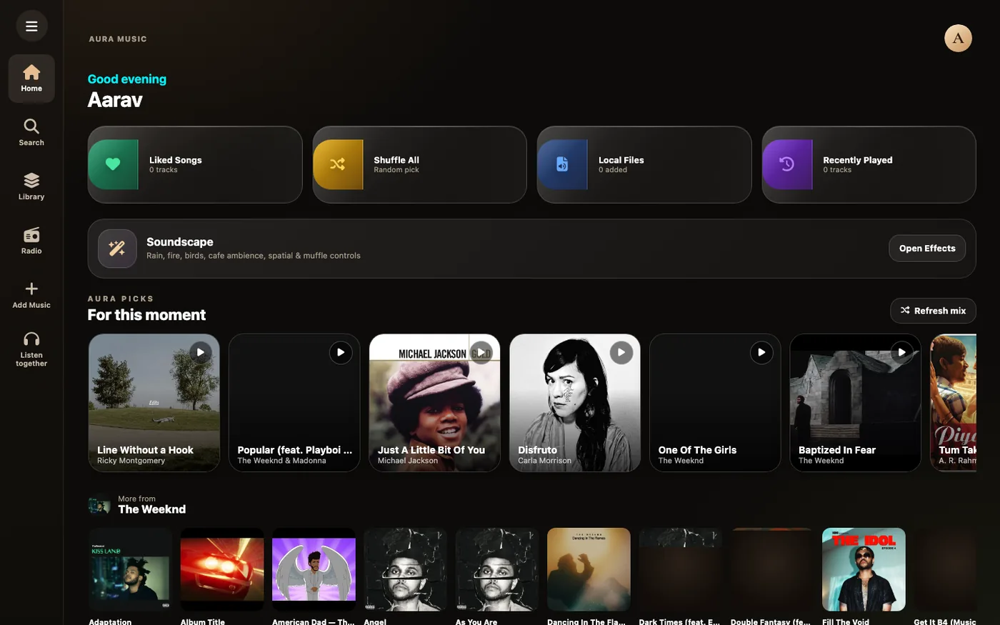
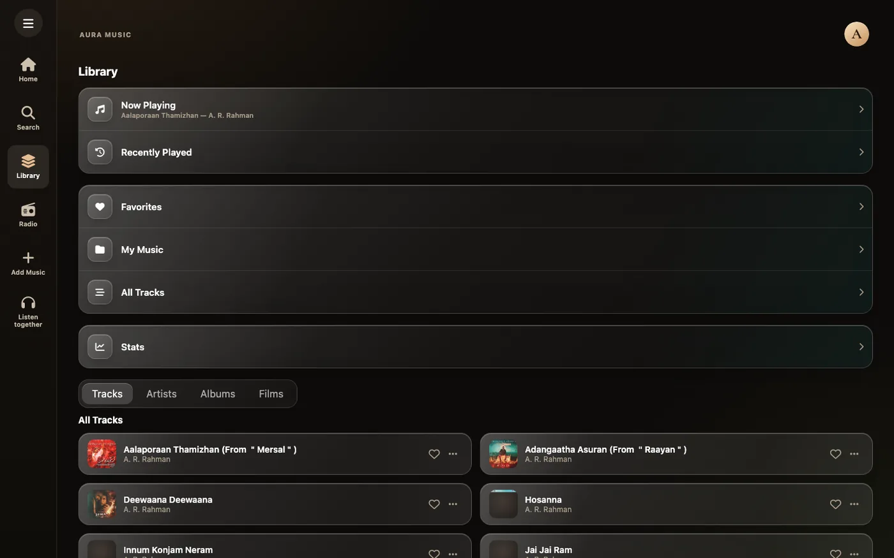
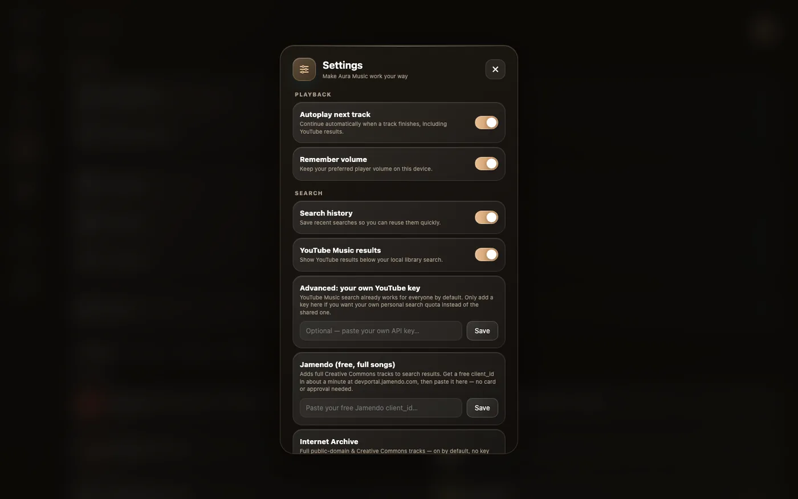
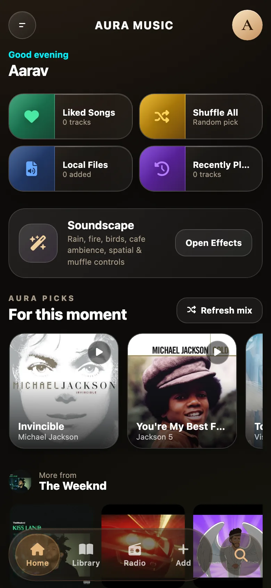

<p align="center">
  
</p>

<h1 align="center">Aura Music</h1>

<p align="center">
  A personal, local-first music player for the web — your own library, live radio,
  synchronized listening rooms and a Discord status that follows what you play.
</p>

<p align="center">
  <a href="https://aura-music-01g.pages.dev">Live app</a> ·
  <a href="docs/README.md">Documentation</a> ·
  <a href="premid/README.md">PreMiD activity</a>
</p>

<p align="center">
  
</p>

## What it is

Aura Music is a single-page music app built with plain TypeScript and Vite. It
does not own a database of users or a streaming service: the library is a
public [Hugging Face storage bucket](https://huggingface.co/buckets/Angelrider/sonora)
maintained by a small admin pipeline, and everything personal (likes, local
files, queue, settings) stays in your browser.

- **Your library** — tracks and cover art streamed from the bucket, with album,
  year and duration metadata from `manifest.json`.
- **Local files** — drop MP3/FLAC/Opus/M4A files in; tags are read client-side and
  audio is stored in IndexedDB.
- **Search & add** — local search plus iTunes, Deezer, Audius, Jamendo,
  Internet Archive, Openverse, ccMixter and YouTube; paste any YouTube,
  Spotify or SoundCloud link.
- **Player** — full player, queue, shuffle/repeat, media keys, art-derived
  theming, YouTube's official embedded player for YouTube tracks.
- **Live radio** — thousands of stations via radio-browser.info plus custom
  stream URLs.
- **Listen Together** — synchronized rooms over WebSocket + a Cloudflare
  Durable Object, with clock sync, shared queue and chat.
- **Discord presence** — a companion [PreMiD activity](premid/README.md) shows
  the current track, artist, cover art and progress, with a deep link back to
  the exact song.
- **Admin pipeline** — a private panel queues YouTube URLs; GitHub Actions
  downloads, tags, uploads to the bucket, writes `manifest.json` and chains
  batches automatically.

## Stack

| Layer | Technology |
| --- | --- |
| UI | Vanilla TypeScript, hand-written CSS (no framework) |
| Build | Vite 7, multi-page (`index.html`, `admin.html`, `rooms.html`) |
| Hosting | Cloudflare Pages + Pages Functions |
| Rooms backend | Cloudflare Workers + Durable Objects (SQLite) |
| Library storage | Hugging Face storage bucket |
| Upload pipeline | GitHub Actions, `yt-dlp`, ffmpeg, `mutagen`, `huggingface_hub` |
| Auth | Google Identity Services + local PBKDF2 fallback |
| Presence | PreMiD v2 activity (Discord OAuth `activities.write`) |

## Quick start

Requirements: Node.js 20 LTS or newer (Vite 7 works best on 20.19+/22.12+), npm,
and a modern browser.

```bash
git clone https://github.com/abhinavthewc-quick/aura-music.git
cd aura-music
npm install
npm run dev
```

Open <http://localhost:5173>. The library and radio work with no configuration.
Online YouTube search needs a key (Settings → advanced, or
`AURA_YOUTUBE_API_KEY` in `src/core/config.ts`), but pasting a YouTube link works
without one. Rooms need the worker running locally — see
[development](docs/development.md#rooms).

### Scripts

| Command | What it does |
| --- | --- |
| `npm run dev` | Vite dev server on `:5173` |
| `npm run build` | Production build into `dist/` |
| `npm run preview` | Preview the built site |
| `npm run typecheck` | `tsc --noEmit` |
| `npm run lint` | Zero-dependency project lint ([`scripts/lint.mjs`](scripts/lint.mjs)) |

## Repository map

```text
aura-music/
├── index.html            # main app shell + markup
├── admin.html            # library/download admin panel
├── rooms.html            # Listen Together page
├── src/
│   ├── main.ts           # app entry
│   ├── app.ts            # boot, catalogue, global error/online states
│   ├── expose.ts         # exposes inline-handler functions on globalThis
│   ├── core/             # config, state, catalogue, auth, presence, DOM utils
│   ├── features/         # player, queue, library, search, radio, home, ambience…
│   ├── ui/               # loader, login, navigation, mini player, a11y
│   ├── rooms/            # room client, referee, sync, Web Audio engine
│   ├── admin/            # admin panel logic
│   └── styles/           # CSS, imported in one cascade order
├── functions/api/        # Cloudflare Pages Functions: /api/admin, /api/rooms
├── lib/                  # sealed-box helper for GitHub secret encryption
├── rooms-worker/         # Cloudflare Worker + Durable Object for rooms
├── scripts/              # manifest/tagging Python + project lint
├── premid/               # PreMiD activity source and setup guide
├── public/               # stable assets (logo, thumbnail)
└── docs/                 # this documentation
```

## Documentation

Start at the [documentation index](docs/README.md).

| Guide | Read it when you want to… |
| --- | --- |
| [Architecture](docs/architecture.md) | understand how the modules, data and playback paths fit together |
| [Features](docs/features.md) | see everything the app can do and how each flow behaves |
| [Configuration](docs/configuration.md) | set up Google auth, keys, Pages env vars and secrets |
| [Development](docs/development.md) | run the app, rooms worker, tests and debug tools |
| [Deployment](docs/deployment.md) | ship the site, functions, worker and upload pipeline |
| [Data model](docs/data-model.md) | understand tracks, bucket layout, manifests and storage keys |
| [Listen Together](docs/rooms.md) | work on the real-time rooms, sync and protocol |
| [Discord presence](docs/presence.md) | understand the presence contract and the PreMiD activity |
| [Admin panel](docs/admin.md) | queue, download and curate the library |
| [Admin API](docs/admin-api.md) | call or extend `/api/admin` |
| [Security](docs/security.md) | review auth, secrets, XSS handling and privacy |
| [Troubleshooting](docs/troubleshooting.md) | diagnose a broken deploy, playback or room |
| [Contributing](docs/contributing.md) | make a safe change and ship it |

## Deployment at a glance

- **Site** — build with `npm run build`, publish `dist/` on Cloudflare Pages;
  `functions/` supplies `/api/admin` and `/api/rooms`.
- **Rooms** — deploy `rooms-worker/` with Wrangler, then point the Pages
  environment variable `ROOMS_WORKER_URL` at it.
- **Uploads** — the admin panel dispatches the `upload-music.yml` GitHub Action,
  which pushes files to the bucket and chains batches of 25.
- **Presence** — copy `premid/websites/A/Aura Music` into the PreMiD Activities
  repo and load it in developer mode. See [premid/README.md](premid/README.md).

Detailed steps, env vars and verification checklists live in
[deployment](docs/deployment.md).

## Screenshots

| Desktop library | Settings | Mobile |
| --- | --- | --- |
|  |  |  |

## Project status

This is a personal project, not a multi-tenant product. There is no user
database: a Google (or local) sign-in only gates the local profile and the
admin allow-list. The library bucket and the Pages deployment are configured
for one owner; a fork needs its own bucket, Google client ID, Pages env vars and
worker URL. No license file is currently declared in the repository.

Useful references:

- [YOUTUBE_SEARCH_IMPL_GUIDE.md](YOUTUBE_SEARCH_IMPL_GUIDE.md) — the InnerTube
  search notes behind the admin search endpoint.
- [premid/README.md](premid/README.md) — the Discord activity setup in detail.
