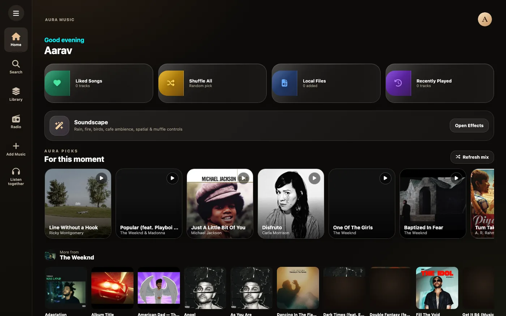
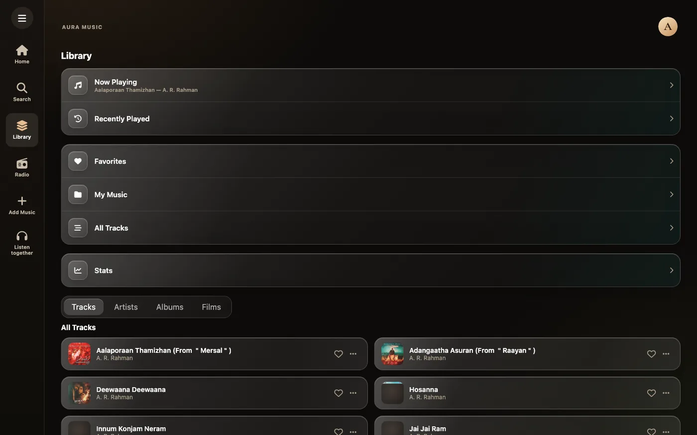
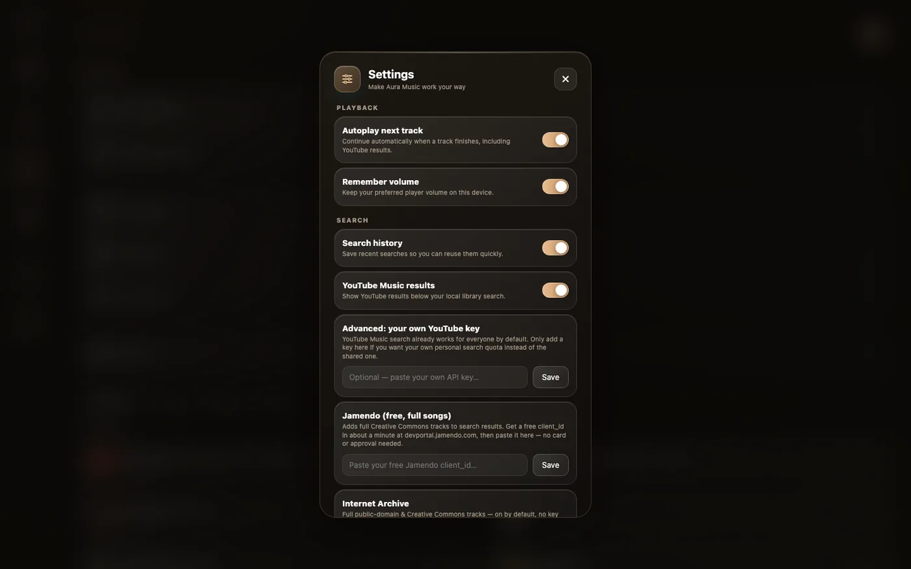
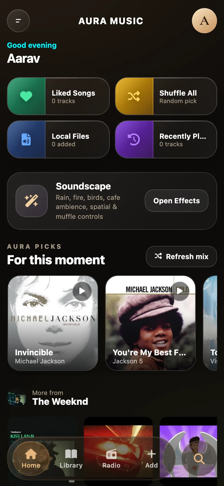

<p align="center">
  
</p>

<h1 align="center">Aura Music</h1>

<p align="center">
  A personal, local-first music player for the web — your own library, live radio,
  synchronized listening rooms and a Discord status that follows what you play.
</p>

<p align="center">
  <a href="https://aura-music-01g.pages.dev">Live app</a> ·
  <a href="docs/README.md">Documentation</a> ·
  <a href="premid/README.md">PreMiD activity</a>
</p>

<p align="center">
  
</p>

## What it is

Aura Music is a single-page music app built with plain TypeScript and Vite. It
does not own a database of users or a streaming service: the library is a
public [Hugging Face storage bucket](https://huggingface.co/buckets/Angelrider/sonora)
maintained by a small admin pipeline, and everything personal (likes, playlists,
queue, settings) stays in your browser.

- **Your library** — tracks and cover art streamed from the bucket, with album,
  year and duration metadata from `manifest.json`. Home and Library share
  centralized artist identities, aliases, portraits and counts.
- **Artist profiles** — automatically fill missing portraits and descriptions
  from Wikimedia sources, with source credits and per-field manual overrides.
  See [automatic artist profiles](docs/artist-metadata.md).
- **Library search** — filters the Aura catalogue by title, artist, album,
  film, favourites, and recent plays. It never mixes preview tracks from other
<<<<<<< HEAD
  services into the library.
- **Playlists** — create, edit, delete, play, and manage device-local playlists;
  share a snapshot link that recipients preview and explicitly save in their own
  browser. Links include up to 100 tracks within a 16 KiB payload; local audio
  stays on the sender’s device. See [playlist sharing](docs/features.md#sharing-a-playlist).
- **Returning listeners** — restore a valid browser session through a loading
  screen with **Reload Aura** recovery; expired sessions return to sign-in.
- **Player** — full player, playlist sequencing, shuffle/repeat, media keys, art-derived
  theming, YouTube's official embedded player for YouTube tracks.
=======
  services into the library. Local files is an actual filter; search does not
  promise podcasts or a new acquisition service.
- **Local audio** — import device files into IndexedDB with filename-based
  title/artist metadata; Restore reconnects a missing blob without losing its
  playlist identity. This is personal audio, not shared-catalogue acquisition.
- **Playlists** — ordered local collections with scoped transport, missing-track
  recovery, pointer/keyboard reorder, and versioned JSON export/import. Sharing
  transfers an importable file, not a misleading public/private cloud link.
  Strict validation/recovery protects saved data; Web Locks or short IndexedDB
  transaction locks coordinate cross-tab writes.
- **Player** — one collection/queue/history domain for Next/Previous, shuffle,
  off/all/one repeat, natural end and media keys; HTML audio and the official
  YouTube iframe remain playback backends inside that domain.
>>>>>>> 62cde5b (Private recovery snapshot before local/production reconciliation (not for deployment))
- **Live radio** — thousands of stations via radio-browser.info plus custom
  stream URLs.
- **Listen Together** — synchronized rooms over WebSocket + a Cloudflare
  Durable Object. Join by code/invite or start a room, invite listeners, browse
  the shared queue, and chat; admins control the music.
- **Discord presence** — a companion [PreMiD activity](premid/README.md) shows
  the current track, artist, cover art and progress, with a deep link back to
  the exact song.
<<<<<<< HEAD
- **Submission pipeline** — intentionally submit YouTube links in Discord via
  [AURA FARMER](https://github.com/angel2rider/AURA-FARMER), maintained in its own
  repository. The private admin panel moderates the queue and GitHub Actions
  downloads, tags, uploads, and updates `manifest.json`.
- **True-black interface** — a `#000` canvas, neutral controls, artwork colour,
  and locally bundled fonts and icons.
=======
- **Archive streaming** — catalogue audio normally starts through `/api/audio`,
  with direct Hugging Face fallback. OCI hot caching is optional, uses server
  environment credentials only, and exposes private aggregate diagnostics.
- **Canonical design** — true black, graphite surfaces and restrained brass;
  artwork supplies the player color instead of competing glass/gradient themes.
- **Submission pipeline** — AURA FARMER accepts YouTube links in Discord, while
  the private admin panel moderates the queue and GitHub Actions downloads,
  tags, uploads, and updates `manifest.json`.
>>>>>>> 62cde5b (Private recovery snapshot before local/production reconciliation (not for deployment))

## Stack

| Layer | Technology |
| --- | --- |
| UI | Vanilla TypeScript, hand-written CSS (no framework) |
| Build | Vite 7, multi-page (`index.html`, `admin.html`, `rooms.html`) |
| Hosting | Cloudflare Pages + Pages Functions |
| Rooms backend | Cloudflare Workers + Durable Objects (SQLite) |
| Library storage | Hugging Face storage bucket |
| Upload pipeline | GitHub Actions, `yt-dlp`, ffmpeg, `mutagen`, `huggingface_hub` |
| Auth | Google Identity Services + local PBKDF2 fallback |
| Presence | PreMiD v2 activity (Discord OAuth `activities.write`) |

## Quick start

Requirements: Node.js 20 LTS or newer (Vite 7 works best on 20.19+/22.12+), npm,
and a modern browser.

```bash
git clone https://github.com/abhinavthewc-quick/aura-music.git
cd aura-music
npm install
npm run dev
```

Open <http://localhost:5173>. The library, library search, playlists, and radio
work with no provider keys. Rooms need the worker running locally — see
[development](docs/development.md#rooms-locally).

### Scripts

| Command | What it does |
| --- | --- |
| `npm run dev` | Vite dev server on `:5173` |
| `npm run build` | Production build into `dist/` |
| `npm run preview` | Preview the built site |
| `npm run typecheck` | `tsc --noEmit` |
| `npm run lint` | Zero-dependency project lint ([`scripts/lint.mjs`](scripts/lint.mjs)) |
| `npm test` | Playwright domain/security tests and isolated browser regressions |
| `npm run test:unit` / `npm run test:e2e` | Focused frontend subsets |
| `bash experiments/telepathy/run-tests.sh -q` | Optional isolated/offline Python research tests after `.venv` setup |

## Repository map

```text
aura-music/
├── index.html            # main app shell + markup
├── admin.html            # library/download admin panel
├── rooms.html            # Listen Together page
├── src/
│   ├── main.ts           # sign-in/session entry
│   ├── runtime.ts        # lazy signed-in music runtime
│   ├── app.ts            # boot, catalogue, global error/online states
│   ├── expose.ts         # exposes inline-handler functions on globalThis
│   ├── core/             # config, state, catalogue, auth, presence, DOM utils
│   ├── features/         # player, queue, library, search, radio, home, ambience…
│   ├── ui/               # loader, login, navigation, mini player, a11y
│   ├── rooms/            # room client, referee, sync, Web Audio engine
│   ├── admin/            # admin panel logic
│   └── styles/           # CSS, imported in one cascade order
├── functions/api/        # Pages: /api/admin, /api/audio, /api/bot, /api/rooms
├── functions/lib/        # server-only OCI signing/cache helpers
├── lib/                  # sealed-box helper for GitHub secret encryption
├── rooms-worker/         # Cloudflare Worker + Durable Object for rooms
├── scripts/              # manifest/tagging Python + project lint
├── premid/               # PreMiD activity source and setup guide
├── public/               # stable assets (logo, thumbnail)
├── tests/                # pure-domain/security and browser regressions
├── experiments/telepathy/# quarantined research service (not bundled/deployed)
└── docs/                 # this documentation
```

## Documentation

Start at the [documentation index](docs/README.md).

| Guide | Read it when you want to… |
| --- | --- |
| [Architecture](docs/architecture.md) | understand how the modules, data and playback paths fit together |
| [Features](docs/features.md) | see everything the app can do and how each flow behaves |
| [Configuration](docs/configuration.md) | set up Google auth, keys, Pages env vars and secrets |
| [Development](docs/development.md) | run the app, rooms worker, tests and debug tools |
| [Deployment](docs/deployment.md) | ship the site, functions, worker and upload pipeline |
| [Data model](docs/data-model.md) | understand tracks, bucket layout, manifests and storage keys |
| [Artist storage](docs/artist-storage.md) | understand shared artist identities and admin-owned metadata |
| [Listen Together](docs/rooms.md) | work on the real-time rooms, sync and protocol |
| [Public resource discovery](docs/discovery.md) | find the public navigation guide, artist directory and discovery documents |
| [Discord presence](docs/presence.md) | understand the presence contract and the PreMiD activity |
| [Admin panel](docs/admin.md) | queue, download and curate the library |
| [Admin API](docs/admin-api.md) | call or extend `/api/admin` |
| [Security](docs/security.md) | review auth, secrets, XSS handling and privacy |
| [Remediation](docs/remediation.md) | review the scoped playback/playlist/design changes, verification gate, and remaining owner infrastructure actions |
| [Troubleshooting](docs/troubleshooting.md) | diagnose a broken deploy, playback or room |
| [Contributing](docs/contributing.md) | make a safe change and ship it |

## Deployment at a glance

- **Site** — build with `npm run build`, publish `dist/` on Cloudflare Pages;
  `functions/` supplies the archive, admin, bot and rooms endpoints. Experimental
  Telepathy endpoints are deliberately outside that deployment directory.
- **Rooms** — deploy `rooms-worker/` with Wrangler, then point the Pages
  environment variable `ROOMS_WORKER_URL` at it.
- **Uploads** — the admin panel dispatches the `upload-music.yml` GitHub Action,
  which pushes files to the bucket and chains batches of 25.
- **Presence** — copy `premid/websites/A/Aura Music` into the PreMiD Activities
  repo and load it in developer mode. See [premid/README.md](premid/README.md).

Detailed steps, env vars and verification checklists live in
[deployment](docs/deployment.md).

## Screenshots

These are earlier documentation captures; they are not release-verification
evidence for the current remediation. Use the current browser suite and its
reviewed desktop/mobile captures when judging the latest interface.

| Desktop library | Settings | Mobile |
| --- | --- | --- |
|  |  |  |

## Project status

This is a personal project, not a multi-tenant product. There is no user
database: a Google (or local) sign-in only gates the local profile and the
admin allow-list. The library bucket and the Pages deployment are configured
for one owner; a fork needs its own bucket, Google client ID, Pages env vars and
worker URL. An application-wide license is not declared; bundled third-party
code and the project-local design skill retain their own notices. The unused
React wrapper was removed; the licensed vanilla loader renderer remains.

The [Telepathy experiment](experiments/telepathy/README.md) is kept only for
research, with explicit packaging, pinned tested dependencies and **14 passing
offline Python tests** in a CPython 3.12 virtual environment. It is not imported
by the listener app or deployed by Pages.

**Owner infrastructure action remains:** revoke/rotate the OCI customer key
that appeared in historical source, set new environment-only values in
Production/Preview, and review IAM/storage activity. Removing defaults locally
neither revokes a remote credential nor deploys the changes; see
[security](docs/security.md#audio-cache-security).

Useful references:

- [YOUTUBE_SEARCH_IMPL_GUIDE.md](YOUTUBE_SEARCH_IMPL_GUIDE.md) — the InnerTube
  search notes behind the admin search endpoint.
- [premid/README.md](premid/README.md) — the Discord activity setup in detail.
