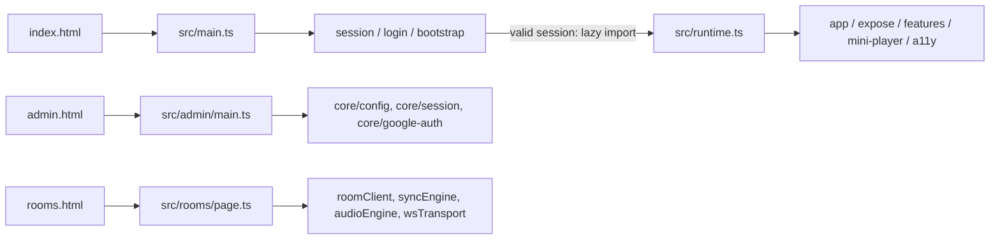
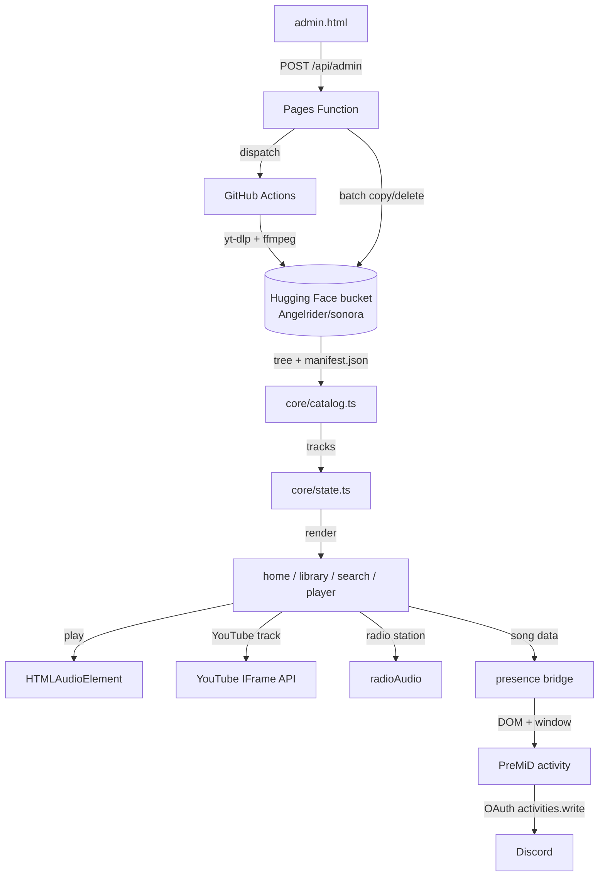

# Architecture

Aura Music is deliberately small in infrastructure and slightly unusual in
structure: a static multi-page Vite app with a handful of companion services,
no application server for normal playback, and browser storage as the only
personal database. This document explains the moving parts and why they are
shaped that way.

## Design constraints

1. **Playback transport is client-side.** Catalogue audio normally starts through
   the Pages `/api/audio` archive proxy, with direct public HF fallback. The
   optional OCI cache is an acceleration layer, not a separate streaming
   catalogue. YouTube uses the official embedded player.
2. **Personal data stays in the browser.** Likes, local uploads, queue state,
   playlists, preferences and profile names live in `localStorage`/IndexedDB.
   There is no user table anywhere.
3. **The library is a bucket, not a database.** Tracks are files in a Hugging
   Face bucket; `manifest.json` adds cleaned metadata keyed by YouTube video id.
   Admin-owned artist metadata lives separately in [D1](artist-storage.md).
4. **The admin panel is a remote control.** It never handles audio bytes; it
   dispatches GitHub Actions that do the downloading/uploading.
5. **Real-time rooms are a separate deployable.** Cloudflare does not allow a
   Durable Object inside a Pages project, so `rooms-worker/` is its own Worker.
6. **Public Search is library-only.** Ingestion starts with intentional Discord
   submissions through [AURA FARMER](https://github.com/angel2rider/AURA-FARMER),
   maintained in a separate repository.
7. **Black is the canvas.** The UI uses `#000`, neutral controls, artwork colour
   and locally bundled fonts/icons.

## Entry points

Vite builds three HTML documents, each with its own dependency graph:



| Entry | URL | Audience |
| --- | --- | --- |
| `index.html` | `/` | Listener app |
| `admin.html` | `/admin` (Pages pretty URL) | Owner-only library/download panel |
| `rooms.html` | `/rooms` | “Listen Together” join/room page |

Pages redirects `*.html` to the clean URL (e.g. `/rooms.html` → 308 →
`/rooms`). Links in the app use `/rooms` and `/admin` accordingly.

## Boot sequence (main app)

```text
index.html
  ├─ entry.css + local fonts
  ├─ saved-session paint hint + reload fallback
  └─ /src/main.ts
       ├─ core/session + ui/login
       └─ core/bootstrap.loadApplication() [valid session]
            └─ lazy /src/runtime.ts
                 ├─ main.css + icons.css
                 ├─ expose / loader / mini-player / a11y / presence-reporter
                 └─ app.ready: local hydration + initial render
```

The HTML hint recognizes a well-formed, unexpired `auraSession_v2` for first
paint; `main.ts` rechecks it through `getSession()`. Signed-out visits remain in
the lightweight entry UI. Returning listeners and successful sign-ins use the
same guarded `loadApplication()` promise. The music app stays hidden/inert until
its runtime is ready and the session is checked again.

Failed startup exposes a status message and **Reload Aura**. A 15-second
recovery path also covers a stalled entry/runtime download; malformed or expired
sessions return to sign-in. This is separate from catalogue retry after entry.

`app.ts` hydrates local tracks and paints cached data, then applies a received
playlist preview or `?play=` link. Catalogue refresh runs in the background and
reconciles the lists; failure exposes the library retry state. Playlist fragments
survive sign-in and take priority over a combined `?play=` parameter. The entry
stays independent of the music store; `runtime.ts` owns the full-app imports.

## Module map

### `src/core/`

| Module | Responsibility |
| --- | --- |
| `config.ts` | Site constants: Google client id and admin allow-list |
| `bootstrap.ts` | Guarded lazy runtime load and ready/session checks |
| `state.ts` | Single mutable `state` object, favourites, catalogue rebuild and active playback context |
| `trackIdentity.ts` | Stable track keys and legacy-key matching, re-exported by state |
| `catalog.ts` | HF tree/manifest/cache, artist-directory refresh and attribution overrides |
| `artistIdentity.ts`, `artistAliases.ts`, `artistGroups.ts` | Shared read-side artist resolution, reviewed aliases and group construction |
| `artistMetadata.ts` | Lazy automatic-profile scheduling, bounded client cache and display refresh events |
| `playlist-sharing.ts` | Bounded snapshot codec, URL construction, omissions and recipient library matching |
| `artistPlayback.ts` | Opt-in artist traversal with raw catalogue IDs and production queue compatibility |
| [playback-context.ts](../src/core/playback-context.ts) | Pure traversal, shuffle/repeat, queue interruptions and history restored by stable track/anchor identity |
| [playlist-data.ts](../src/core/playlist-data.ts) | Strict store/file schemas, validated migration/import/export and corrupt/unsupported format errors |
| [track-identity.ts](../src/core/track-identity.ts) | Direct canonical source identity, legacy-placeholder-only fallback, safe snapshots/artwork and availability |
| `session.ts` | Google session, 7-day token exchange, per-email usernames |
| `google-auth.ts` | Browser-side Google ID-token verification (RS256/JWKS) |
| `local-auth.ts` | Device-local PBKDF2 email/password accounts |
| `presence.ts` | Discord presence bridge: `#auraPresence`, `window.auraPresence`, `AuraPresence.getState` |
| `dom.ts` | Formatting, toast, empty/error state markup, image fallback, YouTube oEmbed metadata |

### `src/features/`

| Module | Responsibility |
| --- | --- |
| `player.ts` | HTML audio playback, YouTube IFrame player, seek/volume, dynamic colours, Media Session |
| `queue.ts` | Personal transport/context integration, Up Next, Play next/Add to queue and track actions |
| `library.ts` | Library/home song lists, legacy saved-track hydration, likes, stats, catalogue retry |
| `search.ts` | Aura catalogue filtering and search categories |
| `playlists.ts` | Versioned local playlists, durable references, missing-track recovery, reorder, file transfer, inline link sharing and read-only previews |
| [radio.ts](../src/features/radio.ts) | Validated live sources, request/intent guards, radio Media Session ownership and paused restoration |
| `home.ts` | Greeting, quick-access tiles, Aura Picks, artist spotlight |
| `ambience.ts` | Web Audio ambient layers, spatial/muffle effects, focus timer |
| `settings.ts` | Settings modal, help, profile popup, sidebar and preference storage |
| `deeplink.ts` | Playback query links and `#playlist=` previews, including later hash arrivals |
| `presence-reporter.ts` | Samples the player and publishes the presence contract once per second/event |

### `src/ui/`

| Module | Responsibility |
| --- | --- |
| `loader.ts` | Intro orb and full-screen loader lifecycle |
| `login.ts` | Google GIS, username picker, email/password fallback |
| `nav.ts` | Tabs, mobile indicator, `aria-current`, lazy radio loading |
| `mini-player.ts` | Desktop bottom bar, seek/volume, shuffle/repeat mirrors |
| `a11y.ts` | Global overlay Escape, modal-only Tab trapping, desktop player-region semantics, focus restore, Enter/Space activation |

### Backend and companions

| Path | Responsibility |
| --- | --- |
| `functions/api/admin.ts` | Authenticated admin API: search, bucket mutations, workflow dispatch, secrets |
| `functions/api/artists.ts`, `functions/api/artist-image.ts` | Public artist metadata/images and authenticated admin edits backed by D1 |
| `functions/api/artist-metadata.ts`, `functions/lib/artistMetadata*.ts` | Cached Wikimedia lookups, identity checks, source credits and shared request budgets |
| `functions/api/audio.ts` | GET/HEAD archive streaming, optional environment-only OCI cache, private aggregate status |
| `functions/lib/ociS3.ts` | RFC 3986 object keys, SigV4 signing, bounded paged listings and cache eviction |
| `functions/api/bot.ts` | Authenticated bridge to the separate Aura Farmer Worker |
| `experiments/telepathy/` | Quarantined browser/API/Python prototype; not bundled or deployed |
| `functions/api/rooms.ts` | Thin Pages proxy to the rooms Worker; adds share URLs |
| `rooms-worker/src/index.ts` | Worker routing, room id/admin key minting, CORS |
| `rooms-worker/src/room.ts` | Durable Object plumbing: sockets, persistence, alarms |
| `src/rooms/referee.ts` | Room rules, shared verbatim between DO and browser dev harness |
| `src/rooms/*` | Client transport, clock sync, sync engine, WebAudio target, page controller |
| `src/rooms/presentation.ts`, `src/rooms/sessionAudio.ts` | Invite/status presentation and session-owned audio lifecycle |
| `scripts/*.py` | Upload pipeline: tag repair and manifest generation |
| `premid/*` | PreMiD activity source + setup |

## Data flow



### Catalogue load

1. At import, `state.hfSongs` is hydrated from `localStorage` cache.
2. The UI paints cached/local tracks immediately.
3. `fetchHfCatalog()` lists bucket files (paged via `Link: rel="next"`, max 20
   pages), reads `manifest.json`, pairs covers by basename, dedupes by song and
   writes the cache.
4. `setHfTracks()` merges in manually added/local tracks and re-renders. Current
   canonical references are resolved by stable/source identity, not a matching
   title/artist or legacy alias.
5. Failure keeps the cached list (if any) and exposes a retry state when the
   list is empty.

### Artist identities

Home, Library, artist pages, portraits and counts share one grouping snapshot.
The resolver prefers admin-owned aliases and intentional attribution corrections,
then conservative formatting and reviewed equivalents. Ambiguous owners remain
separate; supported collaboration credits can reference one recording from
multiple artist groups. Display grouping does not replace persistent track keys
or restart audio. See [Artist storage](artist-storage.md#read-side-artist-identity).

Automatic portraits and biographies are composed after that identity decision.
They live in a separate metadata cache and cannot create profile ownership or
change aliases. Explicit photo/biography overrides win over automatic content.
Post-sign-in scheduling and artist-only refreshes keep provider latency outside
catalogue startup and playback. See [Automatic artist profiles](artist-metadata.md).

### Playlist snapshots

Sharing serializes an allowlisted version-1 snapshot as base64url UTF-8 JSON in
`/#playlist=…`. Limits are 100 tracks including omission counts and 16 KiB decoded
JSON. The fragment carries title/description, track labels/stable keys and counts;
it excludes media/artwork URLs, local audio identifiers and account data. It is
readable by anyone with the link but is not sent as part of the HTTP request.

`deeplink.ts` validates the fragment and `playlists.ts` renders a read-only preview
in `#tabPlaylist`. Explicit Save writes a private copy to `auraPlaylists`,
deduplicating stable keys and retaining missing-track metadata for later library
resolution. Sharing feedback is inline in `#playlistSharePanel`. Preview/import
does not trigger playback, remote discovery, downloads or submissions. See
[Features](features.md#sharing-a-playlist) for the sender and recipient flow.

## Rendering model

There is no framework and no virtual DOM:

- Feature modules render HTML strings into stable containers.
- Inline `onclick`/`oninput` handlers are used in the markup. Every function they
  reference is assigned to `globalThis` in [`src/expose.ts`](../src/expose.ts).
- New dynamic text **must** be escaped with `escapeHtml()` (from `core/dom.ts`,
  re-exported by `features/radio.ts` for legacy imports) before it enters an
  HTML string. Attributes need the same treatment.
- Prefer real button/link elements for interactive rows/cards. Legacy custom
  buttons still use the centralized keyboard layer in
  [`src/ui/a11y.ts`](../src/ui/a11y.ts); do not add a second Enter/Space handler
  that can double-activate a nested control. Escape closes only the top overlay.
- CSS ownership starts at [`src/styles/main.css`](../src/styles/main.css). The
  canonical product language is true black, graphite and neutral controls;
  artwork supplies player color. Numbered patch sheets and separate polish/
  quality/YTM layers are retired. Fix a component in its owner rather than
  adding another final override layer; see [remediation](remediation.md).
- Images get `alt`, `loading="lazy"` and `decoding="async"` unless they are
  above the fold. Failed covers fall back to the vinyl `DEFAULT_COVER` via one
  capture-phase error listener.

## Playback paths

| Source | Engine | Progress / seek | Notes |
| --- | --- | --- | --- |
| Bucket track | `HTMLAudioElement` (`#audioPlayer`) | native `currentTime` / `duration` | `/api/audio` → optional OCI → public HF; direct HF fallback |
| Local file (import/restore) | `HTMLAudioElement` + IndexedDB blob | same | filename metadata; blob URL is session-only |
| Legacy added URL | `HTMLAudioElement` | same | existing supported `http(s)` entries |
| YouTube | official IFrame Player API | `getCurrentTime()` | a playback backend inside the same personal collection context; audio is never extracted |
| Radio | separate `Audio` object | live; no duration | radio-browser.info or custom URL |
| Listen Together | Web Audio `AudioBufferSourceNode` | scheduled clock / explicit seek | separate page and bundle |

Media Session controls use the personal transport just like full/mini-player
buttons and natural end. Radio installs live play/pause/stop handlers, clears
next/previous/seeks and restores the personal handlers when stopped. Rooms keep
server-authoritative transport. A YouTube iframe is a backend, not a dormant
search-result queue or a reason to leave a playlist.

### Personal playback domain

The pure domain stores the collection source/id/label, canonical and effective
orders, cursor/current track, explicit queued interruptions, listening history
and future visits. The integration layer resolves IDs against the current
catalogue at activation time. Numeric render positions are not durable identity.

- Explicit playlist/artist/ordered-collection selection establishes a collection
  and cursor. Ordinary library/search selection retains production fallback
  traversal; it does not implicitly opt into artist playback.
- Next/autoplay moves within it; repeat-all wraps it, repeat-off stops at its end,
  and repeat-one applies to natural end rather than trapping manual Next.
- Shuffle creates a permutation of that collection, not global random picks.
- Queue items interrupt then resume the collection. Previous replays actual
  history, including interruptions; Next after Previous replays future visits
  before pending queued items. Up Next previews that same traversal.
- The mutable raw-ID `manualQueue` and artist `playOrder` remain compatible;
  artist traversal is mirrored into stable-reference `state.playbackContext`.
  Up Next previews at most 4 phone / 30 desktop tracks, and repeat defaults to all.
  Handoffs, retirement, row selection and shuffle retain unheard interruptions,
  including those held only in forward history.
- Visits retain track identity and optional `anchorId` for queued overrides.
  Restoring a visit rebases its cursor by track/anchor identity against the current
  permutation, rather than trusting an old index after shuffle or live reorder.
- Saved playlist order and temporary Up Next order are different concerns.
- Missing tracks are skipped in a bounded traversal, never by falling into an
  unrelated library collection.
- Pending YouTube exclusively owns transport/time: native audio stays paused,
  reported time is zero and seeking is unavailable until the iframe is ready.
  Source/intent guards and exact iframe callback-target validation reject stale
  work; delayed advancement rechecks ownership and actual ended state.

### Local playlist persistence

`auraPlaylists` is a version-2 store with per-playlist schema versions and
snapshot-bearing durable track references. Canonical `id:`/`video:` references
resolve only to direct stable/source identity; unique alias/metadata fallback is
reserved for unresolved `legacy:` placeholders. Strict parsing rejects malformed,
duplicate or unsupported imports, with limits of 16 MiB per import, 2,000 tracks
per playlist and 200 collections. Corrupt saved data freezes writes with a raw
recovery download rather than being discarded. Legacy title/artist strings
migrate only during an explicit playlist mutation or metadata edit, after the
required verbatim recovery copy is saved; failed backup aborts mutation. Startup,
previews, metadata repaints, refresh and library deletion never rewrite playlist
bytes. Unknown references remain placeholders.
Web Locks or a short IndexedDB transaction lock serialize writes; if neither
mechanism is available the app refuses unsafe writes. Storage/BroadcastChannel
update all same-origin views and reconcile active name/order without restarting
audio. A deleted playlist's playback detaches as a labeled snapshot. Export/import
is an explicit file transfer alongside bounded snapshot links, not cloud/public
ACLs or cross-device sync. Legacy privacy/year/shared fields are retained. Local
audio import uses filename metadata; Restore retains the existing local identity.
Local-file operations serialize by raw ID and recheck after awaits; stale edits,
hydration and FileReaders cannot revive deleted/replaced records. Deletion saves
metadata before destroying blobs and finishes transport before awaiting IndexedDB.
Replaced object URLs remain usable until no active native source needs them.
Details: [data model](data-model.md#playlists-and-export-files).

### Live radio ownership

[Radio](../src/features/radio.ts) owns a separate `Audio` object and live transport:

- Validate absolute, credential-free HTTP(S) stream URLs before changing sources;
  discard unsafe directory streams and unsafe optional homepage/favicon URLs.
- Stop active/pending personal YouTube playback and pause personal HTML audio
  without changing saved playlists or the scoped playlist cursor/history. Artist
  transport retires, retaining unheard raw-ID queue interruptions; radio never
  consumes the personal queue or advances a collection.
- Guard station play promises/errors by current selection and request generation.
  Explicit Pause/Stop clears intent and cancels queued foreground recovery.
- Install live play/pause/stop Media Session handlers on selection/resume/restore;
  clear next/previous/all seeks and position state. Stop restores personal handlers
  and metadata. Restoration selects a validated station paused, never autoplaying
  a browser reload.

[Foreground recovery](../src/features/player.ts) uses the guarded radio request
path only if playback was previously active and intent still permits it. Tab
navigation does not itself pause radio; this code cannot override OS/browser
background, codec or autoplay policy.

### Rooms join boundary

[The rooms controller](../src/rooms/page.ts) checks HTTP success before consuming
create/join service data. `exists: false` stops the join, and the returned
WebSocket base must be a credential-free `ws:`/`wss:` URL before transport creation.
Create/join errors appear in the visible `joinBanner`; room-view errors use its
own banner. These are client-side failure boundaries, not evidence that deployed
Workers, live authentication or multi-device synchronization were verified.

### Audio cache boundary

The public archive proxy makes no OCI calls with absent/partial/invalid OCI env.
All errors and logs are sanitized, byte ranges/HEAD remain meaningful, object
keys are encoded by segment, and unknown-length uploads stop at 25 MiB. Cache
writers serialize per isolate, validate capacity before PUT, and skip work if
maintenance fails. The 30-object target is not a globally distributed lock;
strict quotas belong to infrastructure. Diagnostics require a separate bearer
token and expose aggregates only. See [security](security.md#audio-cache-security).

## Presence bridge

The player mirrors “what is playing” into three representations so a browser
extension does not have to scrape the UI:

1. hidden `#auraPresence[data-*]` attributes,
2. `window.auraPresence` (plain object),
3. `window.AuraPresence.getState()` (live position).

The PreMiD activity reads whichever layer is available. The contract is
documented in [presence.md](presence.md); the site-side implementation lives in
[`src/core/presence.ts`](../src/core/presence.ts) and
[`src/features/presence-reporter.ts`](../src/features/presence-reporter.ts).

## Backends

| Endpoint | Host | Purpose |
| --- | --- | --- |
| `/api/admin` | Pages Function | authenticated admin actions (no GET) |
| `/api/audio` | Pages Function → optional OCI / HF | public GET/HEAD archive stream; authorized no-store status aggregates |
| `/api/bot` | Pages Function → separate Worker | authenticated Aura Farmer administration bridge |
| `/api/rooms` | Pages Function → Worker | create/join room, WebSocket upgrade, share URLs |
| `https://aura-rooms.<subdomain>.workers.dev` | Worker + Durable Object | room authority |
| `huggingface.co/api/buckets/.../tree` | HF | catalogue listing |
| `huggingface.co/buckets/.../resolve/...` | HF | audio/cover/manifest bytes |
| `de1.api.radio-browser.info` | public API | radio directory |

Google sign-in verifies ID tokens twice: once in the browser against Google's
JWKS ([`google-auth.ts`](../src/core/google-auth.ts)) and again in the Pages
Function before any GitHub call. The admin panel allow-list is duplicated in
`src/core/config.ts` and `functions/api/admin.ts`; update both.

## Build output

`npm run build` produces:

```text
dist/
├── index.html
├── admin.html
├── rooms.html
├── assets/main-*.js      # sign-in/session entry
├── assets/runtime-*.js   # lazy signed-in runtime
├── assets/admin-*.js
├── assets/rooms-*.js
├── assets/*.css          # entry/runtime/page styles
├── aura-logo.png         # copied from public/
└── aura-thumbnail.png
```

`public/` is copied verbatim (stable URLs for the PreMiD activity). The unused
`src/assets/hero-vinyl.png` is **not** in the bundle; Vite only emits imported
assets. Fonts and icons are bundled locally under `assets/`.

## Failure handling

| Failure | Behaviour |
| --- | --- |
| Catalogue unreachable, no cache | Skeleton → error state with **Try again** → retry action |
| Catalogue unreachable, cache exists | Cached tracks remain; toast explains |
| Broken cover | Capture-phase error listener swaps in the vinyl placeholder |
| Audio error / autoplay block | UI resets, toast explains; `play()` rejections are caught |
| Public Search has no matches | Local empty state; search filters the loaded library only |
| Playlist link invalid / storage unavailable | Visible preview/import error; saving remains an explicit action |
| Native share / clipboard unavailable | Inline status with copy/manual-copy fallback; cancellation stays distinct |
| Optional OCI cache outage/config absent | Public HF archive fallback; no credentials/defaults leaked |
| Playlist reference unavailable | Preserve position and metadata as a remove/relink placeholder |
| YouTube API blocked | Embedded player error is caught and shown as a toast |
| Invalid radio URL | Reject before pausing/changing the currently playing source |
| Radio canceled or station changed | Stale requests cannot revive playback or overwrite the newer selection |
| Room create/join fails or reports missing | Visible join banner; no false-success join or invalid WebSocket transport |
| Rooms disconnect | Client reconnects with backoff; sync engine pauses and re-converges |
| Entry/runtime fails or stalls | Loading status exposes **Reload Aura**; an invalid session returns to sign-in |

## Key design decisions

| Decision | Reason |
| --- | --- |
| Vanilla TS + inline handlers | The app grew from a single HTML file; `expose.ts` keeps that model working without a framework refactor. |
| Static SPA, minimal backends | Normal transport/state stay client-side; Pages supplies public archive streaming and authenticated admin mutations. |
| Pure playback context | Collection identity/order/history are independent of whether audio uses HTML audio or a YouTube iframe. |
| Snapshot links and file exports | Local playlists can be transferred without inventing server-side users, sharing ACLs or synchronized cloud collections. |
| Quarantine experiments | Incomplete recommendation clients/endpoints cannot accidentally bundle or deploy with the listener app. |
| Bucket + manifest instead of a DB | Cheap, simple, and the upload pipeline already produces files; metadata is keyed by video id. |
| GitHub Actions for ingestion | Downloading/tagging is batch work with ffmpeg/yt-dlp, not something a Pages Function can do. |
| Separate rooms Worker | Cloudflare does not allow a Durable Object in a Pages project. |
| Web Audio for rooms | `<audio>` updates in ~33 ms steps and hides output latency; `AudioContext` allows scheduled starts and rate nudges. |
| Presence bridge instead of DOM scraping | UI restyles cannot break the Discord status. |

## Related reading

- [Features](features.md) for the user-facing behaviour.
- [Data model](data-model.md) for track/bucket/storage shapes.
- [Artist storage](artist-storage.md) for identity resolution and metadata ownership.
- [Rooms](rooms.md) for the real-time subsystem.
- [Public resource discovery](discovery.md) for navigation documents and public read access.
- [Deployment](deployment.md) for the Pages/Worker topology.
