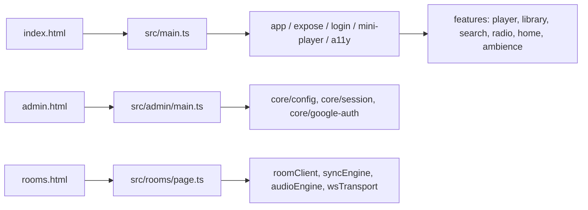
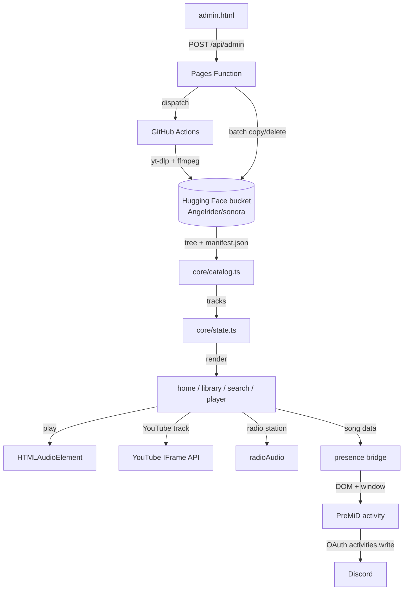

# Architecture

Aura Music is deliberately small in infrastructure and slightly unusual in
structure: a static multi-page Vite app with a handful of companion services,
no application server for normal playback, and browser storage as the only
personal database. This document explains the moving parts and why they are
shaped that way.

## Design constraints

1. **Playback is client-side.** The site streams audio directly from public
   bucket URLs and YouTube's official embedded player. There is no media proxy.
2. **Personal data stays in the browser.** Likes, local uploads, queue state,
   theme and profile names live in `localStorage`/IndexedDB. There is no user
   table anywhere.
3. **The library is a bucket, not a database.** Tracks are files in a Hugging
   Face bucket; `manifest.json` adds cleaned metadata keyed by YouTube video id.
4. **The admin panel is a remote control.** It never handles audio bytes; it
   dispatches GitHub Actions that do the downloading/uploading.
5. **Real-time rooms are a separate deployable.** Cloudflare does not allow a
   Durable Object inside a Pages project, so `rooms-worker/` is its own Worker.

## Entry points

Vite builds three HTML documents, each with its own dependency graph:



| Entry | URL | Audience |
| --- | --- | --- |
| `index.html` | `/` | Listener app |
| `admin.html` | `/admin` (Pages pretty URL) | Owner-only library/download panel |
| `rooms.html` | `/rooms` | “Listen Together” join/room page |

Pages redirects `*.html` to the clean URL (e.g. `/rooms.html` → 308 →
`/rooms`). Links in the app use `/rooms` and `/admin` accordingly.

## Boot sequence (main app)

```text
index.html
  ├─ inline loader CSS + theme bootstrap (reads localStorage auraTheme)
  ├─ main.css (30 stylesheets imported in cascade order)
  └─ /src/main.ts
       ├─ ./ui/loader        orb canvas + intro loader
       ├─ ./app              session, greeting, local tracks, catalogue, deep link
       ├─ ./expose           publishes inline-handler functions on globalThis
       ├─ ./ui/login         Google / local sign-in UI
       ├─ ./ui/mini-player   player bar, volume, media controls
       ├─ ./ui/a11y          Escape, focus trap, keyboard activation
       ├─ ./features/presence-reporter
       └─ installCoverFallback()
```

`app.ts` then:

1. Reads the session and hides the welcome screen if signed in.
2. Sets the catalogue loading flag (skeletons only when there is no cache).
3. Hydrates IndexedDB local tracks, renders the library/home lists.
4. Applies a `?play=` deep link if present.
5. Fetches the remote catalogue in the background; on success rebuilds the
   lists, on failure shows the retryable error state.
6. Starts the presence reporter (separate module) and the idle heartbeat.

Because module evaluation order is significant (state is built at import time),
`src/main.ts` is the only place that decides the order of boot imports.

## Module map

### `src/core/`

| Module | Responsibility |
| --- | --- |
| `config.ts` | Site constants: Google client id, admin allow-list, optional YouTube/Jamendo defaults |
| `state.ts` | Single mutable `state` object, track identity/dedupe (`trackKey`), favourites, catalogue rebuild |
| `catalog.ts` | Hugging Face tree + manifest fetch, filename parsing, title cleaning, cover pairing, cache |
| `session.ts` | Google session, 7-day token exchange, per-email usernames |
| `google-auth.ts` | Browser-side Google ID-token verification (RS256/JWKS) |
| `local-auth.ts` | Device-local PBKDF2 email/password accounts |
| `presence.ts` | Discord presence bridge: `#auraPresence`, `window.auraPresence`, `AuraPresence.getState` |
| `dom.ts` | Formatting, toast, empty/error state markup, image fallback, YouTube oEmbed metadata |

### `src/features/`

| Module | Responsibility |
| --- | --- |
| `player.ts` | HTML audio playback, YouTube IFrame player, seek/volume, dynamic colours, Media Session |
| `queue.ts` | Up-next queue, play next/previous, track sheet actions, queue persistence in memory |
| `library.ts` | Library/home song lists, local-file IndexedDB, add/edit/delete, likes, stats, catalogue retry |
| `search.ts` | Local filtering, multi-provider online search, YouTube link handling, embeds |
| `radio.ts` | radio-browser search, station playback, custom streams, radio sheet |
| `home.ts` | Greeting, quick-access tiles, Aura Picks, artist spotlight |
| `ambience.ts` | Web Audio ambient layers, spatial/muffle effects, focus timer |
| `settings.ts` | Settings modal, theme persistence, help, profile popup, sidebar, settings storage |
| `deeplink.ts` | Consumes `?play=<track id>` and `?play=yt:<videoId>` |
| `presence-reporter.ts` | Samples the player and publishes the presence contract once per second/event |

### `src/ui/`

| Module | Responsibility |
| --- | --- |
| `loader.ts` | Intro orb and full-screen loader lifecycle |
| `login.ts` | Google GIS, username picker, email/password fallback |
| `nav.ts` | Tabs, mobile indicator, `aria-current`, lazy radio loading |
| `mini-player.ts` | Desktop bottom bar, seek/volume, shuffle/repeat mirrors |
| `a11y.ts` | Global overlay Escape, Tab trapping, focus restore, Enter/Space activation |

### Backend and companions

| Path | Responsibility |
| --- | --- |
| `functions/api/admin.ts` | Authenticated admin API: search, bucket mutations, workflow dispatch, secrets |
| `functions/api/rooms.ts` | Thin Pages proxy to the rooms Worker; adds share URLs |
| `rooms-worker/src/index.ts` | Worker routing, room id/admin key minting, CORS |
| `rooms-worker/src/room.ts` | Durable Object plumbing: sockets, persistence, alarms |
| `src/rooms/referee.ts` | Room rules, shared verbatim between DO and browser dev harness |
| `src/rooms/*` | Client transport, clock sync, sync engine, WebAudio target, page controller |
| `scripts/*.py` | Upload pipeline: tag repair and manifest generation |
| `premid/*` | PreMiD activity source + setup |

## Data flow



### Catalogue load

1. At import, `state.hfSongs` is hydrated from `localStorage` cache.
2. The UI paints cached/local tracks immediately.
3. `fetchHfCatalog()` lists bucket files (paged via `Link: rel="next"`, max 20
   pages), reads `manifest.json`, pairs covers by basename, dedupes by song and
   writes the cache.
4. `setHfTracks()` merges in manually added/local tracks, preserves the current
   song by id then by identity key, and re-renders.
5. Failure keeps the cached list (if any) and exposes a retry state when the
   list is empty.

## Rendering model

There is no framework and no virtual DOM:

- Feature modules render HTML strings into stable containers.
- Inline `onclick`/`oninput` handlers are used in the markup. Every function they
  reference is assigned to `globalThis` in [`src/expose.ts`](../src/expose.ts).
- New dynamic text **must** be escaped with `escapeHtml()` (from `core/dom.ts`,
  re-exported by `features/radio.ts` for legacy imports) before it enters an
  HTML string. Attributes need the same treatment.
- Keyboard behaviour is centralized in [`src/ui/a11y.ts`](../src/ui/a11y.ts):
  overlays expose `[aria-modal="true"]`, rows/cards use
  `role="button" tabindex="0"`, and Escape closes only the top overlay.
- CSS is one cascade: [`src/styles/main.css`](../src/styles/main.css) imports
  every stylesheet in order; later files intentionally override earlier ones
  (`overrides-*.css`). Add new page styles near the end rather than relying on
  `!important` in a random file.
- Images get `alt`, `loading="lazy"` and `decoding="async"` unless they are
  above the fold. Failed covers fall back to the vinyl `DEFAULT_COVER` via one
  capture-phase error listener.

## Playback paths

| Source | Engine | Progress / seek | Notes |
| --- | --- | --- | --- |
| Bucket track | `HTMLAudioElement` (`#audioPlayer`) | native `currentTime` / `duration` | streams public bucket URLs |
| Local upload | `HTMLAudioElement` + IndexedDB blob | same | blob URL is session-only |
| Manual URL | `HTMLAudioElement` | same | must be `http(s)` |
| YouTube | official IFrame Player API | `getCurrentTime()` polled every 500 ms | audio is never extracted |
| Radio | separate `Audio` object | live; no duration | radio-browser.info or custom URL |
| Listen Together | Web Audio `AudioBufferSourceNode` | scheduled clock / explicit seek | separate page and bundle |

Media Session metadata is updated for the main player and radio, so OS media
keys and lock-screen controls work without any server involvement.

## Presence bridge

The player mirrors “what is playing” into three representations so a browser
extension does not have to scrape the UI:

1. hidden `#auraPresence[data-*]` attributes,
2. `window.auraPresence` (plain object),
3. `window.AuraPresence.getState()` (live position).

The PreMiD activity reads whichever layer is available. The contract is
documented in [presence.md](presence.md); the site-side implementation lives in
[`src/core/presence.ts`](../src/core/presence.ts) and
[`src/features/presence-reporter.ts`](../src/features/presence-reporter.ts).

## Backends

| Endpoint | Host | Purpose |
| --- | --- | --- |
| `/api/admin` | Pages Function | authenticated admin actions (no GET) |
| `/api/rooms` | Pages Function → Worker | create/join room, WebSocket upgrade, share URLs |
| `https://aura-rooms.<subdomain>.workers.dev` | Worker + Durable Object | room authority |
| `huggingface.co/api/buckets/.../tree` | HF | catalogue listing |
| `huggingface.co/buckets/.../resolve/...` | HF | audio/cover/manifest bytes |
| `de1.api.radio-browser.info` | public API | radio directory |
| provider APIs | iTunes/Deezer/Audius/Jamendo/Archive/Openverse/ccMixter/YouTube | search |

Google sign-in verifies ID tokens twice: once in the browser against Google's
JWKS ([`google-auth.ts`](../src/core/google-auth.ts)) and again in the Pages
Function before any GitHub call. The admin panel allow-list is duplicated in
`src/core/config.ts` and `functions/api/admin.ts`; update both.

## Build output

`npm run build` produces:

```text
dist/
├── index.html
├── admin.html
├── rooms.html
├── assets/main-*.js      # ~125 KB (39 KB gzip)
├── assets/admin-*.js     # ~30 KB
├── assets/rooms-*.js     # ~29 KB
├── assets/main-*.css     # ~177 KB (34 KB gzip)
├── aura-logo.png         # copied from public/
└── aura-thumbnail.png
```

`public/` is copied verbatim (stable URLs for the PreMiD activity). The unused
`src/assets/hero-vinyl.png` is **not** in the bundle; Vite only emits imported
assets. The sidebar logo is a 16 KB 512 px WebP.

## Failure handling

| Failure | Behaviour |
| --- | --- |
| Catalogue unreachable, no cache | Skeleton → error state with **Try again** → retry action |
| Catalogue unreachable, cache exists | Cached tracks remain; toast explains |
| Broken cover | Capture-phase error listener swaps in the vinyl placeholder |
| Audio error / autoplay block | UI resets, toast explains; `play()` rejections are caught |
| Search provider failures | `Promise.allSettled`; other providers still render; retry state |
| YouTube API blocked | Embedded player error is caught and shown as a toast |
| Rooms disconnect | Client reconnects with backoff; sync engine pauses and re-converges |
| Loader stalls | 8-second failsafe animation removes the loader overlay |

## Key design decisions

| Decision | Reason |
| --- | --- |
| Vanilla TS + inline handlers | The app grew from a single HTML file; `expose.ts` keeps that model working without a framework refactor. |
| Static SPA, no app server | Playback and library reads are public; only admin mutations need a server. |
| Bucket + manifest instead of a DB | Cheap, simple, and the upload pipeline already produces files; metadata is keyed by video id. |
| GitHub Actions for ingestion | Downloading/tagging is batch work with ffmpeg/yt-dlp, not something a Pages Function can do. |
| Separate rooms Worker | Cloudflare does not allow a Durable Object in a Pages project. |
| Web Audio for rooms | `<audio>` updates in ~33 ms steps and hides output latency; `AudioContext` allows scheduled starts and rate nudges. |
| Presence bridge instead of DOM scraping | UI restyles cannot break the Discord status. |

## Related reading

- [Features](features.md) for the user-facing behaviour.
- [Data model](data-model.md) for track/bucket/storage shapes.
- [Rooms](rooms.md) for the real-time subsystem.
- [Deployment](deployment.md) for the Pages/Worker topology.
