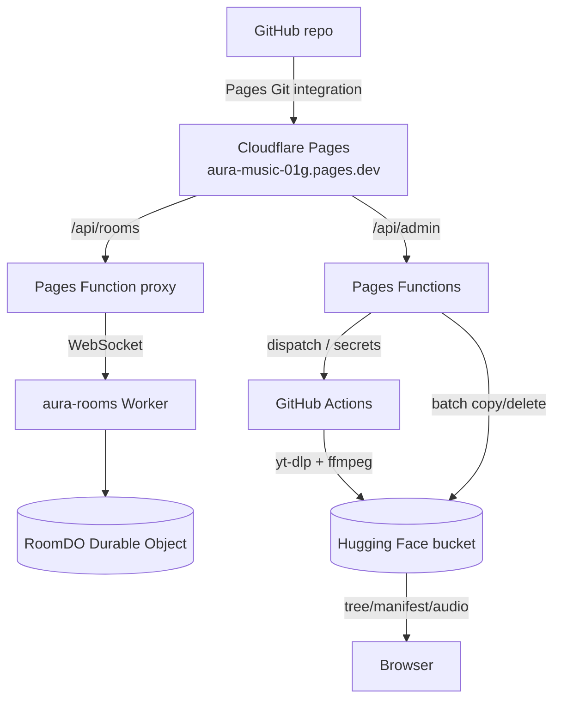

# Deployment

The app has four independently deployable pieces:

1. **Cloudflare Pages site** — static app + two Pages Functions.
2. **Rooms Worker** — Cloudflare Worker + Durable Object.
3. **GitHub Actions** — upload/manage pipeline (no separate server).
4. **PreMiD activity** — optional; loaded from the Activities repo/dev mode.



## 1. Cloudflare Pages

### Project settings

| Setting | Value |
| --- | --- |
| Git repository | this repo (`abhinavthewc-quick/aura-music`) |
| Production branch | `main` |
| Build command | `npm run build` |
| Output directory | `dist` |
| Root directory | repository root |
| Functions directory | `functions` (default) |
| Node version | 20+ (set `NODE_VERSION` if the default is older) |

Cloudflare automatically detects `functions/api/admin.ts` and
`functions/api/rooms.ts` and exposes them at `/api/admin` and `/api/rooms`.
The build emits `index.html`, `admin.html` and `rooms.html`; Pages’ pretty URLs
serve `/`, `/admin` and `/rooms` (`*.html` requests 308 to the clean URL).

All Pages environment variables are listed in
[configuration](configuration.md#2-cloudflare-pages-environment). They are
server-side; never put them in `src/core/config.ts`.

### Manual deploy

If you deploy from a laptop instead of Git integration:

```bash
npm ci
npm run build
npx wrangler pages deploy dist --project-name aura-music-01g
```

`wrangler` needs a Cloudflare login/token. The Pages project name is the
subdomain part of the URL (`aura-music-01g`). Git integration is preferred: every
push to `main` rebuilds the site.

### Cache and routes

- Hashed assets under `dist/assets/` are content-addressed by Vite.
- `public/aura-logo.png` and `public/aura-thumbnail.png` are stable URLs used by
  the PreMiD activity and docs; if you replace them, the CDN may serve the old
  copy until its cache expires.
- There is no `_headers` or `_redirects` file; Pages’ defaults are used.
  `index.html` is served with `cache-control: max-age=0, must-revalidate`.
- Internal links use `/rooms` and `/admin`; keep the pretty URLs enabled.

### Rollback

Pages keeps deployments. Use **Workers & Pages → project → Deployments** and
roll back to a previous build, or revert the commit and push. The bucket and
rooms Worker are independent, so a site rollback does not remove uploaded music
or active room state.

## 2. Rooms Worker

Cloudflare does not allow a Durable Object inside a Pages project. Deploy it
separately:

```bash
cd rooms-worker
npm ci
npx wrangler deploy
```

`wrangler.jsonc` already defines:

- Worker name `aura-rooms`
- account id `78b14a211589525aa3b866632a83d155`
- binding `ROOM_OBJECT` → class `RoomDO`
- migration `v1` with `new_sqlite_classes: ["RoomDO"]`
- observability enabled

After the first deploy, copy the printed URL (or the custom route) into the
Pages environment as `ROOMS_WORKER_URL`:

```text
ROOMS_WORKER_URL = https://aura-rooms.<subdomain>.workers.dev
```

The Pages Function appends `/?action=create` and `/?room=…` and adds share URLs in
the canonical `/rooms?r=<id>` form (the page’s share button uses the same). The
Worker derives the WebSocket base from the request host, so it works behind the
Pages proxy and in local dev.

### Changing Durable Object state

The object stores a single `room` record with a schema tag. If you change the
stored shape:

1. Bump `SCHEMA` in `rooms-worker/src/room.ts`.
2. Add a new migration tag in `wrangler.jsonc` if the class itself changes.
3. Old rooms are discarded rather than migrated (they are ephemeral by design).

### Local worker

```bash
cd rooms-worker
npm install
npx wrangler dev --port 8799
```

Vite proxies `/api/rooms` there by default. The e2e test:

```bash
node rooms-worker/test/e2e.mjs ws://localhost:8799
```

## 3. GitHub Actions

### `upload-music.yml`

Manually dispatched (by the admin panel or **Actions → Run workflow**) with:

| Input | Meaning |
| --- | --- |
| `urls` | YouTube/YouTube Music URLs, one per line (first batch) |
| `meta` | JSON `[{id,title,artist,album}]` for the first batch |
| `more_urls` | Remaining URLs for the chain |
| `more_meta` | Metadata for the remaining URLs |

Pipeline:

1. Installs `yt-dlp`, static `ffmpeg`/`ffprobe`, `huggingface_hub` and `mutagen`
   (network-bound work runs in parallel).
2. Downloads audio as Opus (`-f 251` fallbacks), with cookies if present,
   `--embed-thumbnail`/`--embed-metadata`, and two fallback player clients for
   URLs that fail on the first pass.
3. Repairs missing tags with `scripts/fix_metadata.py`.
4. Syncs files to the HF bucket with `hf buckets sync` (skips sidecars/partials).
5. Builds `manifest.json` with `scripts/build_manifest.py`.
6. Dispatches the **next** run with the remaining URLs (chained batches), so one
   click can process a large queue without keeping a browser tab open.

Limits: the API allows at most 300 URLs per dispatch and splits 25 per run; a
run has a 90-minute timeout and `concurrency: upload-music` (GitHub keeps only
one pending run in a group, hence the chain instead of dispatching all batches
up front). The admin API refuses a new dispatch while a run is
`in_progress`/`queued` (HTTP 409).

Required secrets: `HF_TOKEN`, `HF_BUCKET_ID`, optional `YOUTUBE_COOKIES`,
optional `GH_TOKEN` (for the chain step; otherwise `GITHUB_TOKEN` with
`actions: write` is used).

### `manage-music.yml`

Bucket mutations that need **new bytes** (cover art, updated manifest) cannot
use the HF batch copy/delete endpoint. The admin panel:

1. Stages the new bytes into `.staging/` in the repo via the GitHub Contents
   API.
2. Dispatches `manage-music.yml` with `op` (`cover`/`manifest`), `staged_path`
   and `target_path`.
3. The workflow checks out the repo, uses `hf buckets cp` with the
   repository-held `HF_TOKEN`, then removes the staged file and commits the
   cleanup.

Inputs: `op` (`cover` | `manifest`), `staged_path`, `target_path`.
Required secrets: `HF_TOKEN`, `HF_BUCKET_ID`.

### Secret rotation

- Change `GH_TOKEN`, `GOOGLE_CLIENT_ID`, `ADMIN_PASSWORD`, `HF_TOKEN`,
  `HF_BUCKET_ID` or `ROOMS_WORKER_URL` in Pages → Settings → Environment
  variables, then trigger a new deployment (env changes apply to new builds).
- `YOUTUBE_COOKIES` can be rotated from the admin panel’s Settings tab; it writes
  the encrypted secret through GitHub’s public key.
- Revoke the old tokens at the provider after rotating. Admin fallback sessions
  are HMAC-signed with `GH_TOKEN`, so rotating `GH_TOKEN` invalidates existing
  password sessions (users sign in again).

## 4. PreMiD activity

The activity is not part of the Pages build. It lives in
[`premid/websites/A/Aura Music`](../premid/websites/A/Aura%20Music):

1. Create the Discord application (name **Aura Music**, upload the logo).
2. Set `CLIENT_ID` in `presence.ts`.
3. Deploy the site first so `/aura-logo.png` and the presence bridge exist.
4. Copy the folder into a clone of `PreMiD/Activities` under `websites/A/`.
5. Enable **Activity Developer Mode** in the PreMiD extension; run
   `npx pmd dev "Aura Music"`.
6. Optionally submit a PR to the PreMiD store.

Full steps: [premid/README.md](../premid/README.md) and
[presence.md](presence.md).

## Deployment verification checklist

- [ ] `npm run typecheck`, `npm run lint`, `npm run build` pass.
- [ ] `https://<site>/` loads; the catalogue paints (skeleton first on cold cache).
- [ ] `/admin` gate appears; Google sign-in succeeds; `/api/admin` returns 200.
- [ ] `/rooms` opens; creating a room returns an id; joining from a second
      browser works.
- [ ] `/api/rooms` returns 503 with a clear message when `ROOMS_WORKER_URL` is
      unset (expected in a fresh environment).
- [ ] Uploading one URL from the admin panel creates a workflow run and the
      track appears in the library after the run finishes.
- [ ] A cover/manifest edit dispatches `manage-music.yml` and the change appears.
- [ ] The Discord activity shows the current track, cover and progress.
- [ ] Crawl `/` and `/auth`-less pages on mobile: no horizontal overflow, dock
      controls tappable.
- [ ] `curl -I https://<site>/assets/<hashed>.js` returns long-lived cache
      headers; `/` is `no-cache`/must-revalidate.

## Operational notes

- **No staging environment is defined.** Preview deployments can be used, but
  they will hit the same bucket unless you point `HF_BUCKET_ID` at a test bucket
  and use a separate Google OAuth origin.
- **No app-level CI.** `.github/workflows` only contains the music pipeline.
  Typecheck/lint/build are manual gates; consider adding a small CI workflow if
  more contributors join.
- **No custom HTTP headers/CSP** are configured. The app loads Font Awesome,
  Google Fonts and jsmediatags from CDNs and uses inline event handlers, so a
  strict CSP would need a separate migration. See [security](security.md).
- **Keep `main` deployable.** Pages builds `main` automatically; a broken
  `npm run build` blocks deployment but does not take down the previous build.
