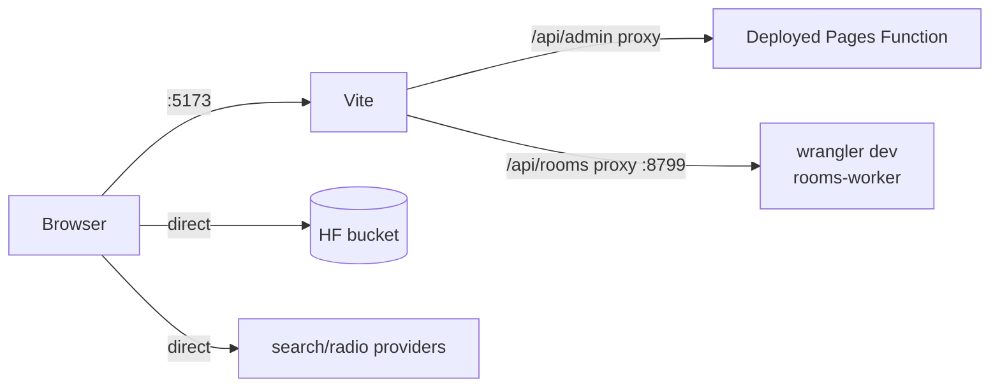

# Development

## Prerequisites

- Node.js **20 LTS or newer** (the current build was tested on Node 26; Vite 7
  prefers 20.19+/22.12+).
- npm (the repo has `package-lock.json`; `npm ci` is fine).
- A modern Chromium/Firefox/Safari for testing.
- For rooms: Docker is **not** required; `wrangler` runs the Worker locally.
- For the admin API locally: either use the proxy to the deployed Pages Function
  (default) or run `wrangler pages dev` with the env vars (see below).

## Install and run

```bash
npm ci
npm run dev
```

Open <http://localhost:5173>. Vite serves the three entries at `/`,
`/admin.html` and `/rooms.html` (the app links to `/rooms` and `/admin`; Vite
serves those clean URLs too).

### Scripts

| Command | Description |
| --- | --- |
| `npm run dev` | Vite dev server with HMR |
| `npm run build` | Production build to `dist/` |
| `npm run preview` | Serve the built site |
| `npm run typecheck` | TypeScript check only |
| `npm run lint` | Project invariants (see below) |

The lint is intentionally small: no ESLint toolchain exists in this project, so
[`scripts/lint.mjs`](../scripts/lint.mjs) enforces the rules that caused real
bugs — no `console.log`/`debugger`, typed buttons, image `alt`, unique ids,
`rel="noopener"`, no placeholder-image services.

## Local topology



### Admin locally

`/api/admin` is proxied to `https://aura-music-01g.pages.dev` by
`vite.config.js`, so local admin testing uses the deployed Function and its
secrets. That means a local change to `functions/api/admin.ts` is **not** used
until you run the Function locally:

```bash
npm run build
npx wrangler pages dev dist \
  --compatibility-date 2025-09-01 \
  --binding GH_TOKEN=... GOOGLE_CLIENT_ID=... ADMIN_PASSWORD=... HF_TOKEN=... HF_BUCKET_ID=...
```

Point the Vite proxy at that local server if you do (edit the proxy target, or
test the admin page through the wrangler server).

### Rooms locally

```bash
cd rooms-worker
npm install
npx wrangler dev --port 8799
```

Then in another terminal:

```bash
npm run dev
# open /rooms?r=<code> or create a room from the page
```

`ROOMS_DEV_URL` overrides the proxy target:

```bash
ROOMS_DEV_URL=http://localhost:8800 npm run dev
```

There are two additional harnesses:

| URL | What it does |
| --- | --- |
| `/rooms-dev.html` | Runs the room against the **BroadcastChannel** local referee — no Worker needed. Open two tabs to simulate two listeners. |
| `/sync-test.html` | Builds two independent audio pipelines in one tab and reports their distance in ms. Use it to verify sync convergence rather than “each client vs server”. |

The rooms Worker also has an end-to-end test with two real WebSocket clients:

```bash
node rooms-worker/test/e2e.mjs ws://localhost:8799
```

It covers roles, admin enforcement, queue/playback messages and room isolation.
Run it after changing `referee.ts` or `room.ts`; both the browser and the Worker
share the same referee implementation.

### Pages Functions locally

The Pages Functions are plain Workers modules. `wrangler pages dev` is the
closest local production match; the Vite proxy exists because most UI work does
not need to run the Function. Env vars are passed with `--binding` (or a
`.dev.vars` file) and must match the names in
[configuration](configuration.md#2-cloudflare-pages-environment).

## Debug toolbox

Open DevTools on the main app. These globals are intentionally available:

| Global | What it gives you |
| --- | --- |
| `state` | The live app store (`songs`, `currentIndex`, `audio`, `isPlaying`, …) |
| `songs` / `currentIndex` | Read-only accessors for inline inspection |
| `$('id')` | `document.getElementById` |
| `playSong(index)` | Start any track by index |
| `goTab(tabId)` | Switch tabs (`tabHome`, `tabSearch`, `tabLibrary`, `tabRadio`, `tabProfile`) |
| `AuraPresence.getState()` | Current presence snapshot, including extrapolated position |
| `window.auraPresence` | Last published plain snapshot |
| `document.getElementById('auraPresence').dataset` | Same data as text attributes |
| `__auraMiniProgress` | Mini-player progress API (`apply`, `reset`) |
| `window.__aura` | Loader stylesheet counter (`sheets`) |
| `searchLikedSong(id)` | Open a saved YouTube song in Search by title |

Useful checks:

```js
state.songs.length
state.songs[state.currentIndex]
document.getElementById('auraPresence').dataset
AuraPresence.getState()
document.querySelectorAll('.tab-content.active').length
```

Rooms exposes drift/clock diagnostics in its own UI; the `SyncEngine` keeps
`driftMs`, `clockOffsetMs`, `inSync` and `nudging` in the room view.

## Testing

There is no committed unit/UI test framework. The minimum gate is:

```bash
npm run typecheck
npm run lint
npm run build
```

Manual smoke checklist before shipping:

1. Home paints with cached or remote tracks; skeleton appears on a cold cache.
2. Play a bucket track; pause/resume; seek; next/previous; like.
3. Play a YouTube track (or paste a link); the official iframe opens.
4. Play a radio station; stop it.
5. Add a local file; reload; it still plays from IndexedDB.
6. Search 1 character (no online fan-out), 3+ characters (online results),
   pasted links, “Try again” after blocking the network.
7. Open Settings; Tab stays inside; Escape closes; theme survives reload.
8. Open the row “…” menu on a bucket track (string id), Escape closes it.
9. Rooms: create, join from a second tab, play/pause/seek/queue/chat, leave.
10. Mobile viewport: no horizontal overflow; dock controls are tappable.
11. PreMiD: activity updates, buttons/links behave (see [presence](presence.md)).

A headless smoke can be scripted with Chrome DevTools Protocol; keep such
scripts out of the production bundle and never ship assertions that depend on
the live catalogue.

## Code conventions

### HTML strings & escaping

- Dynamic text/attribute values **must** go through `escapeHtml()`.
- Do not put raw ids into inline JavaScript. Put the id in a `data-*` attribute
  and delegate the click (see the row menu in `library.ts`/`queue.ts`).
- Prefer `textContent` for new UI; use `innerHTML` only for known templates.

### Inline handlers

The app still relies on `onclick="..."`. If an inline handler needs a function,
add it to the `Object.assign(globalThis, …)` block in
[`src/expose.ts`](../src/expose.ts). Keep that list intentionally small; new
code should prefer `addEventListener` inside a module.

### Accessibility

- Dialogs use `role="dialog" aria-modal="true"` and a visible close control.
- Clickable non-buttons use `role="button" tabindex="0"`; the global a11y layer
  handles Enter/Space.
- Icon-only controls need `aria-label`; toggles need `aria-pressed`.
- Never hide a focused subtree with `aria-hidden` before restoring focus
  (the a11y layer already orders this correctly).
- Add `loading="lazy" decoding="async"` to new below-the-fold images, `alt=""`
  for decorative covers, real alt text otherwise.
- Respect `prefers-reduced-motion`; the app also has a Reduce motion setting.

### CSS

- `src/styles/main.css` controls import order. Later files override earlier ones
  deliberately (`overrides-*`, `mobile-dock`, `vinyl-final`).
- New components should use the tokens in `:root` (`--radius-*`, `--ease-out`,
  `--dur`, `--focus-ring`, `--skeleton`) instead of one-off values.
- Keep mobile rules inside `@media (max-width:899px)` (or the existing smaller
  breakpoints) and test at 390 px.
- Do not use `!important` unless overriding a legacy rule in an `overrides-*.css`
  file.

### State & persistence

- Add new persisted keys with a version suffix (`*_v1`) and document them in
  [data-model](data-model.md).
- Never rename/remove a key without a migration; users keep local data forever.
- Catalogue dedupe identity is `trackKey()`; don’t invent a second identifier.

### Performance

- Batch list rendering; avoid `findIndex` inside a row render (use an index map).
- Lazy-load below-the-fold media; don’t preload third-party SDKs.
- Debounce network-triggering input; cancel/ignore stale results with tokens.
- Clear timers/listeners you create; the app is a SPA and modules live for the
  whole session.

## Common tasks

### Add a search provider

1. Write `searchX(query)` returning objects with
   `{ source, id, title, artist, img, preview?, full? }`.
2. Add it to the `Promise.allSettled` array in `searchYouTubePro`.
3. Add its badge/branch in `outsideResultRowHTML`.
4. If playback differs, handle it in `playOutsideResult`.
5. Add it to the provider table in [features](features.md#online-search).

### Add a setting

1. Add the control to `#settingsModal` in `index.html` with a stable id.
2. Add the default to `defaultAuraSettings` in `settings.ts`.
3. Read it in `applyAuraSettings` and include it in the `onchange` loop.
4. Use `auraSettings.<key>` where applicable; persist via `saveAuraSettings()`.
5. Document the setting in [features](features.md#settings).

### Add a track action

1. Add a row in `openTrackMenu` (`queue.ts`) with `queueTrackAction('…')`.
2. Handle the action in `queueTrackAction`.
3. Keep the sheet keyboard-accessible (rows already get role/tabindex).
4. If it needs a new global handler for an inline event, register it in
   `expose.ts`.

### Change the presence contract

1. Update `src/core/presence.ts` and `presence-reporter.ts`.
2. Update `premid/.../state.ts` and `presence.ts`.
3. Update [presence.md](presence.md) and `premid/README.md`.
4. Reload the activity with `pmd dev`; the extension stores compiled code and
   will keep serving the old version otherwise.

## Legacy tools

`tools/*.mjs` are one-off scripts used to split the original single-file app into
modules and assets (`split-js`, `split-css`, `wire-imports`, `segments`,
`strip-html`, `extract-assets`, `type-fixes`). They are not part of the build.
Do not run them against the current tree unless you intentionally want to
regenerate the split; they assume the original `index.html` structure.

## Git

- Keep commits focused; the repo history uses descriptive sentence-style
  subjects.
- Do not commit generated `dist/`, `.wrangler/` state, or node_modules.
- Update docs in the same commit as behaviour changes.
- The app has no CI workflow for typecheck/build; run the local gate before
  pushing (`.github/workflows` is only the upload/manage pipeline).
