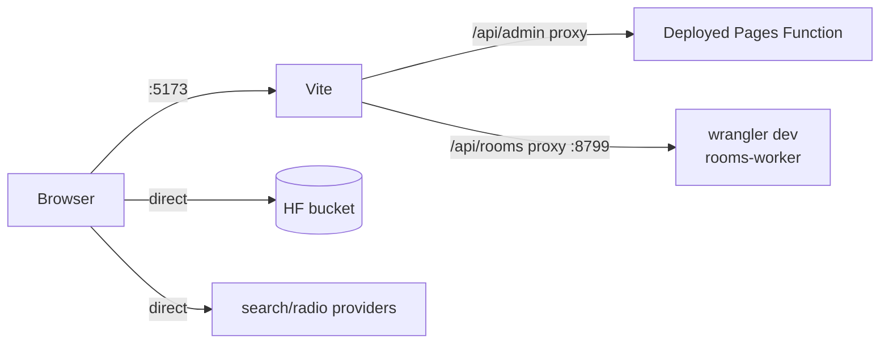

# Development

## Prerequisites

- Node.js **20.19+ or 22.12+** (or a compatible later release) for Vite 7.
- npm (the repo has `package-lock.json`; `npm ci` is fine).
- A modern Chromium/Firefox/Safari for device-specific smoke testing. Automated
  Playwright tests use installed Playwright Chromium by default; run
  `npx playwright install chromium`, or set `PLAYWRIGHT_CHANNEL=chrome` for an
  installed Google Chrome.
- Optional experiment tests: CPython **3.12** and an isolated virtual environment;
  no global pip installation is required.
- For rooms: Docker is **not** required; `wrangler` runs the Worker locally.
- For the admin API locally: either use the proxy to the deployed Pages Function
  (default) or run `wrangler pages dev` with the env vars (see below).

## Install and run

```bash
npm ci
npm run dev
```

Open <http://localhost:5173>. Vite serves the three entries at `/`,
`/admin.html` and `/rooms.html` (the app links to `/rooms` and `/admin`; Vite
serves those clean URLs too).

### Scripts

| Command | Description |
| --- | --- |
| `npm run dev` | Vite dev server with HMR |
| `npm run build` | Production build to `dist/` |
| `npm run preview` | Serve the built site |
| `npm run typecheck` | TypeScript check only |
| `npm run lint` | Project invariants (see below) |
| `npm test` | Playwright pure-domain/server security tests and browser regressions |
| `npm run test:unit` | Unit/domain/security subset |
| `npm run test:e2e` | Isolated browser-flow subset |
| `npm run test:artists` | Node artist identity/metadata/storage regressions |
| `npm run test:playback` | Node source-ownership and collection transport regressions |
| `npm run test:playlists` | Node version-1 sharing codec regressions |
| `npm run test:artists:browser` | Local-only retained regression fixture server (default port 5186) |
| `bash experiments/telepathy/run-tests.sh -q` | Optional offline Python experiment suite, using its own `.venv` |

The lint is intentionally small: no ESLint toolchain exists in this project, so
[`scripts/lint.mjs`](../scripts/lint.mjs) enforces the rules that caused real
bugs — no `console.log`/`debugger`, typed buttons, image `alt`, unique ids,
`rel="noopener"`, no placeholder-image services.

## Local topology



### Admin locally

`/api/admin` is proxied to `https://aura-music-01g.pages.dev` by
`vite.config.js`, so local admin testing uses the deployed Function and its
secrets. That means a local change to `functions/api/admin.ts` is **not** used
until you run the Function locally:

```bash
npm run build
npx wrangler pages dev dist \
  --compatibility-date 2025-09-01 \
  --binding GH_TOKEN=... GOOGLE_CLIENT_ID=... ADMIN_PASSWORD=... HF_TOKEN=... HF_BUCKET_ID=...
```

Point the Vite proxy at that local server if you do (edit the proxy target, or
test the admin page through the wrangler server).

### Rooms locally

```bash
cd rooms-worker
npm install
npx wrangler dev --port 8799
```

Then in another terminal:

```bash
npm run dev
# open /rooms?r=<code> or create a room from the page
```

`ROOMS_DEV_URL` overrides the proxy target:

```bash
ROOMS_DEV_URL=http://localhost:8800 npm run dev
```

There are two additional harnesses:

| URL | What it does |
| --- | --- |
| `/rooms-dev.html` | Runs the room against the **BroadcastChannel** local referee — no Worker needed. Open two tabs to simulate two listeners. |
| `/sync-test.html` | Builds two independent audio pipelines in one tab and reports their distance in ms. Use it to verify sync convergence rather than “each client vs server”. |

The rooms Worker also has an end-to-end test with two real WebSocket clients:

```bash
node rooms-worker/test/e2e.mjs ws://localhost:8799
```

It covers roles, admin enforcement, queue/playback messages and room isolation.
Run it after changing `referee.ts` or `room.ts`; both the browser and the Worker
share the same referee implementation.

### Pages Functions locally

The Pages Functions are plain Workers modules. `wrangler pages dev` is the
closest local production match; the Vite proxy exists because most UI work does
not need to run the Function. Env vars are passed with `--binding` (or a
`.dev.vars` file) and must match the names in
[configuration](configuration.md#2-cloudflare-pages-environment).

## Debug toolbox

Open DevTools on the main app. These globals are intentionally available:

| Global | What it gives you |
| --- | --- |
| `state` | The live app store (`songs`, `currentIndex`, `audio`, `isPlaying`, …) |
| `songs` / `currentIndex` | Read-only accessors for inline inspection |
| `$('id')` | `document.getElementById` |
| `playSong(index)` | Start any track by index |
| `goTab(tabId)` | Switch tabs (`tabHome`, `tabSearch`, `tabLibrary`, `tabPlaylists`, `tabRadio`) |
| `AuraPresence.getState()` | Current presence snapshot, including extrapolated position |
| `window.auraPresence` | Last published plain snapshot |
| `document.getElementById('auraPresence').dataset` | Same data as text attributes |
| `__auraMiniProgress` | Mini-player progress API (`apply`, `reset`) |
| `window.__aura` | Loader stylesheet counter (`sheets`) |
| `searchLikedSong(id)` | Open a saved YouTube song in Search by title |

Useful checks:

```js
state.songs.length
state.songs[state.currentIndex]
document.getElementById('auraPresence').dataset
AuraPresence.getState()
document.querySelectorAll('.tab-content.active').length
```

Rooms exposes drift/clock diagnostics in its own UI; the `SyncEngine` keeps
`driftMs`, `clockOffsetMs`, `inSync` and `nudging` in the room view.

## Testing

The automated gate is:

```bash
npm run typecheck
npm run lint
npm test
npm run test:artists
npm run test:playback
npm run test:playlists
npm run build
```

Playwright tests seed an isolated local catalogue/profile and use local fixtures,
not the owner's production catalogue or accounts. Audio security tests substitute
all fetches and use explicit fake credentials; they cover disabled/partial OCI
env, status authorization, URI-key signing, ranges/HEAD, bounded uploads, sanitized
errors, pagination and failed-capacity behavior. Do not inject real keys or
live endpoints into test fixtures. Playwright discovers only `**/*.spec.ts`;
Node `*.test.ts` suites have separate runners and isolated fixture state. For
targeted browser runs use `npx playwright test tests/e2e/<name>.spec.ts`, not the
E2E npm script, which already prepends the entire E2E directory.

The retained/native-input suite runs separately against its local-only fixture
server; see [artist fixture setup](artist-storage.md#browser-fixtures) and
[playback regressions](../tests/playback/README.md). Give it a dedicated port and
output directory, never a production origin. [Remediation](remediation.md#verification)
records the current 116 Playwright tests, 266 Node tests and 1,236 retained/native
checks. These runners cover different contracts, not interchangeable totals.

Run the full frontend suite once at a time: its managed development server uses
port 5199. Concurrent independent unit/e2e invocations can race the same port or
Vite's optimizer cache. Traces/screenshots under `test-results/` are generated
failure evidence and ignored by Git, not source deliverables.

### Optional Python research tests

Telepathy is quarantined, not a prerequisite for running/building the listener
app. Its package has explicit setuptools discovery and a `test` extra including
pytest/pytest-asyncio and SQLAlchemy's asyncio dependencies.

```bash
python3.12 -m venv experiments/telepathy/.venv
experiments/telepathy/.venv/bin/python -m pip install \
  -r experiments/telepathy/requirements-test.lock
experiments/telepathy/.venv/bin/python -m pip install --no-deps \
  -e experiments/telepathy
bash experiments/telepathy/run-tests.sh -q
```

The runner refuses a global interpreter. It and the test bootstrap replace an
inherited `DATABASE_URL` with in-memory SQLite before importing the singleton,
clear provider credentials, supply deterministic metadata/lyrics, block external
HTTP and Internet sockets, and use ASGITransport for in-process API tests. No
live database, metadata provider or deployed Function is contacted. Exact
historically verified dependencies and **14/14 research tests** are documented in
[the experiment README](../experiments/telepathy/README.md). Scientific packages
need compatible wheels; CPython 3.12 was verified, unlike the host's newest
interpreter. The Python result was not rerun during the 13 November reconciliation.

### Deployment/device smoke checklist

1. Home/catalogue loading, cache and retry states.
2. Library/playlist/artist transport, queue interruptions, Next/Previous,
   off/all/one repeat, shuffle, seek, like, and media keys.
3. Export/import round-trip, missing placeholders/relink, metadata edits, ordered
   membership, cross-tab updates and deletion while detail/picker is open.
4. A supported legacy/deep-linked YouTube track uses the official iframe; natural
   end follows its active collection. Confirm real mobile autoplay policy.
5. Radio play/pause/stop and supported live codec; rooms create/join/chat/transport
   with two clients and the real Worker when configured.
6. Import device audio using filename metadata; reload to hydrate it. A missing
   blob exposes Restore and does not strand autoplay. No jsmediatags/tagging
   provider is promised; shared catalogue acquisition still belongs to Discord.
7. Library-only search categories, including Local files; no podcast wording or
   online acquisition fan-out. Search → playlist clears Search body/layout state.
8. Settings/dialog keyboard focus, topmost Escape, reduced motion and black theme;
   390 px touch/overflow, desktop full player and all icon-only accessible names.
9. PreMiD activity and deep links against the extension/device environment.
10. Audio proxy behavior in an owner-approved staging environment. **Do not
    probe a production status route or use historical credentials as a test.**

Third-party lyrics/radio/YouTube/Google, room deployment, and the external PreMiD
extension cannot be exhaustively verified by mocked local tests. See
[remediation](remediation.md) for release boundaries.

## Code conventions

### HTML strings & escaping

- Dynamic text/attribute values **must** go through `escapeHtml()`.
- Do not put raw ids into inline JavaScript. Put the id in a `data-*` attribute
  and delegate the click (see the row menu in `library.ts`/`queue.ts`).
- Prefer `textContent` for new UI; use `innerHTML` only for known templates.

### Inline handlers

The app still relies on `onclick="..."`. If an inline handler needs a function,
add it to the `Object.assign(globalThis, …)` block in
[`src/expose.ts`](../src/expose.ts). Keep that list intentionally small; new
code should prefer `addEventListener` inside a module.

### Accessibility

- Dialogs use `role="dialog" aria-modal="true"` and a visible close control.
- Desktop full-player/transport surfaces are nonmodal; docked Up Next is a
  `role="region"` without `aria-modal` and must not trap Tab. Phone overlays
  retain the modal focus scope.
- Prefer native buttons/links for interactive rows and nested actions. Legacy
  custom buttons use `role="button" tabindex="0"` and the global a11y activation;
  do not layer another Enter/Space handler on top of it.
- Icon-only controls need `aria-label`; toggles need `aria-pressed`.
- Never hide a focused subtree with `aria-hidden` before restoring focus
  (the a11y layer already orders this correctly).
- Add `loading="lazy" decoding="async"` to new below-the-fold images, `alt=""`
  for decorative covers, real alt text otherwise.
- Respect `prefers-reduced-motion`; the app also has a Reduce motion setting.

### CSS

- `src/styles/main.css` declares component ownership and layer/import order.
  Numbered patches and the separate YTM/polish/quality passes are retired; do not
  add another final override file.
- Canonical listener palette: true black, graphite elevations, legible neutral
  text, white interaction states, and artwork-led player color. Legacy light
  preferences do not change that palette.
- Use shared color/radius/type/motion/focus tokens rather than per-component
  gradients, arbitrary radii, or scattered `!important` fights.
- Keep mobile rules in their responsive owner and test at 390 px. Structural
  tokens are shared between desktop/mobile; layouts can differ deliberately.
- A component change belongs in that component's stylesheet. Remove superseded
  declarations rather than hiding them under a new patch.

### State & persistence

- Add new persisted keys with a version suffix (`*_v1`) and document them in
  [data-model](data-model.md).
- Never rename/remove a key without a migration; users keep local data forever.
- `trackKey()` is catalogue dedupe/migration, not playlist identity. Persist
  durable video/id references with snapshots, and preserve unresolved entries.
- Every explicit collection selection must establish a playback context. Engine-specific
  code must not invent its own Next/Previous/shuffle path or a fallback into the
  global library at a playlist boundary.
- Use strict `playlist-data.ts` parsing; unsupported/corrupt saved formats freeze
  writes with recovery rather than becoming empty storage. Prepare migration
  before track metadata edits, saving the required legacy backup first. Startup,
  previews, refreshes and library deletion never migrate playlists.
- Web Locks or a short IndexedDB transaction coordination lock protect playlist
  writes; if neither is available, refuse unsafe saving. BroadcastChannel/storage
  update all same-origin views and active collection metadata/order without
  restarting current audio. These mechanisms are not a cloud service.
- Preserve the mutable raw-ID `manualQueue` and artist `playOrder` contract;
  mirror artist traversal into stable-reference `state.playbackContext`. Retain
  unheard interruptions during handoffs, shuffle and temporary reorder.
- Serialize local-file operations by ID and recheck after every await. Persist
  deletion metadata before removing a blob, and finish transport changes before
  awaiting IndexedDB deletion. Keep numeric `toggleFavorite` arguments as indices;
  use strings for internal raw-ID calls.
- A pending YouTube selection owns transport/time exclusively; never play or seek
  the paused prior HTML source. Stale source promises/events cannot win ownership.

### Performance

- Batch list rendering; avoid `findIndex` inside a row render (use an index map).
- Lazy-load below-the-fold media; don’t preload third-party SDKs.
- Debounce network-triggering input; cancel/ignore stale results with tokens.
- Clear timers/listeners you create; the app is a SPA and modules live for the
  whole session.

## Common tasks

### Extend library search

Listener search filters the existing Aura library only. Add a category/filter in
`search.ts`, label it truthfully, establish a matching playback context on row
activation, and add a browser regression. Do not restore removed preview
providers, podcast promises, or acquisition forms without an explicit product
scope decision. Music acquisition belongs to the separate Discord/admin pipeline.

### Add a setting

1. Add the control to `#settingsModal` in `index.html` with a stable id.
2. Add the default to `defaultAuraSettings` in `settings.ts`.
3. Read it in `applyAuraSettings` and include it in the `onchange` loop.
4. Use `auraSettings.<key>` where applicable; persist via `saveAuraSettings()`.
5. Document the setting in [features](features.md#settings).

### Add a track action

1. Add a row in `openTrackMenu` (`queue.ts`) with `queueTrackAction('…')`.
2. Handle the action in `queueTrackAction`.
3. Keep the sheet keyboard-accessible (rows already get role/tabindex).
4. If it needs a new global handler for an inline event, register it in
   `expose.ts`.

### Change the presence contract

1. Update `src/core/presence.ts` and `presence-reporter.ts`.
2. Update `premid/.../state.ts` and `presence.ts`.
3. Update [presence.md](presence.md) and `premid/README.md`.
4. Reload the activity with `pmd dev`; the extension stores compiled code and
   will keep serving the old version otherwise.

## Legacy tools

`tools/*.mjs` are one-off scripts used to split the original single-file app into
modules and assets (`split-js`, `split-css`, `wire-imports`, `segments`,
`strip-html`, `extract-assets`, `type-fixes`). They are not part of the build.
Do not run them against the current tree unless you intentionally want to
regenerate the split; they assume the original `index.html` structure.

## Git

- Keep commits focused; the repo history uses descriptive sentence-style
  subjects.
- Do not commit generated `dist/`, `.wrangler/` state, or node_modules.
- Update docs in the same commit as behaviour changes.
- The app has no CI workflow for typecheck/build; run the local gate before
  pushing (`.github/workflows` is only the upload/manage pipeline).
