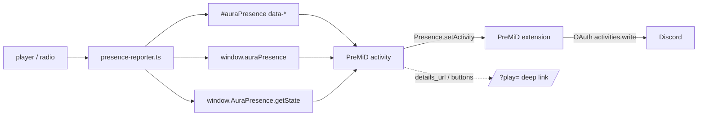

# Discord presence (PreMiD)

Aura Music ships a companion [PreMiD](https://premid.app) activity that shows the
current track on Discord: cover art, song title, artist, playback progress, live
radio state, and links back to the exact song. PreMiD is a browser extension; as
of the current v2 it links Discord through OAuth (`activities.write`) and runs a
headless session itself. **No PreMiD desktop app and no Discord desktop client
are required** — only the extension, a Discord account, and the activity loaded
(developer mode).

The activity source lives in
[`premid/websites/A/Aura Music`](../premid/websites/A/Aura%20Music) and has its
own detailed setup guide in [premid/README.md](../premid/README.md).

## How it fits together



The site never imports Discord code. The activity never scrapes the player UI.

## The page contract

Published by [`src/core/presence.ts`](../src/core/presence.ts) and refreshed by
[`src/features/presence-reporter.ts`](../src/features/presence-reporter.ts)
once per second and on media events.

### 1. Hidden DOM node

```html
<div id="auraPresence" hidden aria-hidden="true"
     data-v="1" data-site="Aura Music" data-kind="track"
     data-title="Aarabhi" data-artist="A. R. Rahman" data-album="…"
     data-cover="https://…/cover.webp" data-url="https://…/"
     data-link="https://…/?play=hf%3A…"
     data-video-id="dQw4w9WgXcQ" data-duration="213.4" data-position="42.1"
     data-playing="1" data-live="0" data-tab="Library"
     data-updated-at="1793456344000"></div>
```

### 2. Plain object

`window.auraPresence` is the latest snapshot
(`{v, site, kind, title, artist, album, cover, url, link, videoId, duration,
position, playing, live, tab, updatedAt}`).

### 3. Read API

`window.AuraPresence.getState()` returns the same object with the position
extrapolated to “now”. `window.AuraPresence.version` and `.site` are also
available.

### Fields

| Field | Meaning |
| --- | --- |
| `kind` | `idle`, `track` or `radio` |
| `title`, `artist`, `album` | Display strings (already cleaned where appropriate) |
| `cover` | Absolute `http(s)` artwork URL, or `''` (falls back to the site logo) |
| `url` | Canonical item URL (YouTube watch page for YouTube tracks) |
| `link` | Deep link that opens **and plays** the exact item in Aura |
| `videoId` | 11-character YouTube id or `''` |
| `duration` / `position` | Seconds; `0` for live radio |
| `playing` | Whether audio is progressing |
| `live` | Radio/live stream (no meaningful duration) |
| `tab` | `Home`, `Search`, `Library`, `Radio`, `Add Music` |
| `updatedAt` | Epoch **milliseconds** of the last publish; used to extrapolate |

`kind: 'idle'` is emitted even when nothing has ever played, so the activity can
show “Browsing Aura Music — <tab>”.

### Position accuracy

The reporter publishes a fresh position at least once per second (and on
`timeupdate`, play, pause, seek and visibility change). The activity can also
compute a live position from `updatedAt`, so Discord’s elapsed/remaining bar
tracks playback even between messages. Live radio never gets timestamps.

## Deep links

The activity’s primary button and clickable title use `link`:

| Link | Target |
| --- | --- |
| `/?play=<track id>` | bucket/local/added track (`hf:…`, numeric id, etc.) |
| `/?play=yt:<videoId>` | YouTube track, played inside Aura |

[`src/features/deeplink.ts`](../src/features/deeplink.ts) consumes the parameter
on load, finds the track, starts it, and removes `?play` from the address. If the
bucket catalogue is still loading it waits and retries after the fetch.

The activity also offers a **Play on YouTube** button for YouTube tracks.

## Activity behaviour

| Page state | Discord card |
| --- | --- |
| Nothing playing | “Browsing Aura Music” + active tab + elapsed time |
| Track playing | title, artist, cover, elapsed/remaining progress |
| Track paused | pause icon, no timer (Discord cannot render a frozen bar) |
| YouTube | title, cover, progress, **Listen in Aura Music** + **Play on YouTube** |
| Live radio | station name, country/tags, `Live radio` icon, no timer |
| Privacy mode | “Listening to Aura Music” only |

Settings exposed by the activity:

| Setting | Default | Effect |
| --- | --- | --- |
| Privacy Mode | off | hide title/artist/cover and buttons |
| Show Cover Art | on | use cover art instead of the site logo |
| Show Playback Progress | on | add start/end timestamps while playing |
| Pick Status Display | Activity Name | member-list text: app / artist / song |
| Show Buttons | on | show the link buttons (Discord may hide them) |
| Hide When Paused | off | clear the activity when paused |
| Show Browsing | on | show “Browsing Aura Music” when idle |
| Activity Type | Listening | switch to Playing if a client hides buttons on Listening cards |

**Button visibility caveat:** PreMiD always includes the buttons in its payload,
but Discord’s activity card decides whether to render them. The activity also
sets `details_url`, `state_url` and `assets.large_url`, so the title, artist and
cover are clickable as a fallback. If the card still hides them, switch
**Activity Type** to **Playing** and compare.

## Compatibility

The host page exposes three layers so older/newer extensions work:

| Layer | Extension version |
| --- | --- |
| `window.AuraPresence.getState()` via `execInPage` | 2.14+ |
| `window.auraPresence` via `getPageVariable` | 2.5+ |
| `#auraPresence[data-*]` | any content script |

The activity [state reader](../premid/websites/A/Aura%20Music/state.ts) tries
the page variable, then `execInPage`, then the DOM attributes.

## Setup (short version)

1. Create a Discord application named **Aura Music**; upload
   [`public/aura-logo.png`](../public/aura-logo.png) as its icon.
2. Put its Application ID in `CLIENT_ID` at the top of
   [`premid/.../presence.ts`](../premid/websites/A/Aura%20Music/presence.ts).
3. Deploy the site (the bridge and `/aura-logo.png` must be live).
4. Copy the activity folder into a clone of `PreMiD/Activities` under
   `websites/A/Aura Music`.
5. Enable **Activity Developer Mode** in the PreMiD extension; in the Activities
   repo run:
   ```bash
   npx pmd dev "Aura Music"
   ```
6. Open the site, play something, and check Discord. Keep the CLI running while
   iterating; the extension keeps the compiled activity after it stops.

Full instructions, including publishing to the store, are in
[premid/README.md](../premid/README.md).

`pmd dev` is only a loader/updater. The extension stores the compiled activity
in its `devActivities` IndexedDB and runs it independently; a long-running
terminal is not required after the first load. Re-run it after editing the
activity files or clearing extension data.

## Debugging

- **Extension popup** → Developer → your activity should have a **Dev** badge.
- **F12 → PreMiD** DevTools panel shows the current `PresenceData`, timestamps
  and button payload. This is the fastest way to see whether the activity is
  producing data.
- **Service worker console** (`chrome://extensions` → PreMiD → service worker)
  shows auth/send failures such as `Failed to set activity on Discord`.
- In the page console:
  ```js
  document.getElementById('auraPresence').dataset
  AuraPresence.getState()
  ```
- If the activity does not update, confirm the site tab is the active tab and
  the presence reporter is running (the DOM attributes change every second
  while music plays).
- If Discord shows nothing at all, check that the PreMiD extension has a linked
  Discord account and that its session has not expired. Re-linking Discord
  triggers a fresh OAuth grant.

## Privacy

The presence data is only what is deliberately listed above: media metadata and
the current app tab. It contains no email, session token, local file names
(beyond the track title you see in the app), or browsing history. The activity
runs locally; Discord receives the rendered activity through PreMiD’s OAuth
session. Privacy Mode reduces it to a generic “Listening to Aura Music”.

## Files

| File | Purpose |
| --- | --- |
| [`src/core/presence.ts`](../src/core/presence.ts) | DOM node + window API + live state |
| [`src/features/presence-reporter.ts`](../src/features/presence-reporter.ts) | samples the player and publishes |
| [`src/features/deeplink.ts`](../src/features/deeplink.ts) | consumes `?play=` links |
| [`premid/.../presence.ts`](../premid/websites/A/Aura%20Music/presence.ts) | Discord activity |
| [`premid/.../state.ts`](../premid/websites/A/Aura%20Music/state.ts) | contract reader (unit-testable) |
| [`premid/.../metadata.json`](../premid/websites/A/Aura%20Music/metadata.json) | store metadata, settings, domain match |
