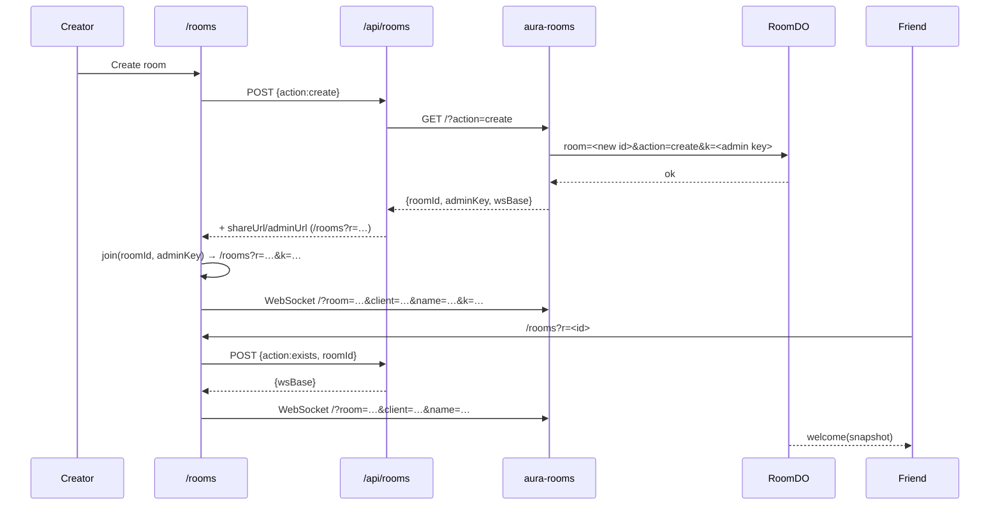

# Listen Together (rooms)

A room is one shared playback session. One admin controls the transport; every
listener hears the same audio at the same moment, sees the same queue, and can
chat. The room survives brief disconnects and closes on its own when nobody
comes back.

Rooms are a **separate page and bundle** (`/rooms`, `src/rooms/`) with a
**separate backend** (`rooms-worker/`), because a Cloudflare Durable Object
cannot live inside a Pages project.

## User flow



- **Create** mints a 6-character room id (`abcdefghjkmnpqrstuvwxyz23456789`) and
  a 32-hex-character admin key. The key is the authority; whoever presents it
  becomes admin.
- **Share**: `/rooms?r=<roomId>`; the creator’s URL also carries `&k=<adminKey>`.
  Treat the admin URL as a password — anyone with it can control playback.
- **Join**: the page asks `/api/rooms` (action `exists`) for the worker’s
  `wsBase`, then opens a WebSocket with a name and client id.
- **Leave**: closing the tab/socket removes the participant; an empty room
  starts a 3-minute grace countdown.

## Topology

| Layer | File | Role |
| --- | --- | --- |
| Page | `rooms.html`, `src/rooms/page.ts` | join/room UI, chat, queue, pills, share, live loop |
| Client | `src/rooms/roomClient.ts` | high-level verbs, refuses admin-only actions locally (server re-checks) |
| Transport | `src/rooms/wsTransport.ts` | WebSocket + heartbeat/reconnect |
| Sync | `src/rooms/syncEngine.ts` | clock-based expectation, schedule, drift correction |
| Audio | `src/rooms/audioEngine.ts` | Web Audio target (whole-track decode, schedule, latency) |
| Clock | `src/rooms/clock.ts` | ping/pong offset estimation |
| Protocol | `src/rooms/protocol.ts` | shared messages/state/constants |
| Referee | `src/rooms/referee.ts` | authoritative rules, shared by browser and Worker |
| Worker | `rooms-worker/src/index.ts` | id/key minting, CORS, Durable Object routing |
| Object | `rooms-worker/src/room.ts` | sockets, persistence, alarms, lifecycle |
| Proxy | `functions/api/rooms.ts` | Pages → Worker, share URLs, `ROOMS_WORKER_URL` |

The worker is reached directly for the WebSocket (`wsBase` from the worker), not
through the Pages Function. The Function only creates/existence-checks rooms.

## Authority model

Only admins may change playback or the queue, so there is never more than one
controller and no conflict resolution when two people press play.

- The creator’s **admin key** is stored by the DO and bound to whichever client
  presents it last, so reconnecting from a new tab keeps control.
- Listeners can browse, chat and watch; the client refuses admin verbs locally
  for a responsive UI, and `RoomReferee` ignores them server-side.
- Admins can **promote/demote** listeners. The last admin cannot be demoted
  (that would orphan the room).
- If the last admin leaves while listeners remain, a **30-second rescue
  window** starts. During it, any listener who sends a control message is
  promoted to admin. If nobody claims it, the room closes.
- If everyone leaves, the room survives for **3 minutes** (`GRACE_MS`) and is
  then closed/deleted.
- Chat is capped at 500 characters, 200 messages of history, 5 messages per 5 s
  per connection. A reconnect gets a new client id, so the rate window resets.

## Protocol

Types and constants live in [`src/rooms/protocol.ts`](../src/rooms/protocol.ts).

### Client → server

| Message | Payload | Notes |
| --- | --- | --- |
| `hello` | `clientId`, `name`, `adminKey?` | join/auth; server replies `welcome` |
| `ping` | `sentAt` | clock sync; server replies `pong` |
| `control` | `action: play\|pause\|seek\|track`, `start?`, `positionMs?`, `trackKey?`, `videoId?` | admin only |
| `queue` | `action: add\|remove\|clear\|next`, `trackKey?` | admin only |
| `role` | `action: promote\|demote`, `participantId` | admin only |
| `chat` | `text` | rate-limited |
| `buffering` | `buffering` | advisory in v1 |
| `bye` | — | clean leave |

### Server → client

| Message | Payload | Meaning |
| --- | --- | --- |
| `welcome` | `you`, `snapshot`, `serverTime` | initial state |
| `playback` | `playback`, `serverTime` | authoritative transport state |
| `queue` | `queue`, `serverTime` | shared queue changed |
| `participants` | `participants`, `serverTime` | joins/leaves/roles |
| `chat` | `message` | broadcast chat |
| `closing` | `reason` | room ending |
| `pong` | `sentAt`, `serverTime` | clock sample |

`PlaybackState` carries `trackKey`, `videoId`, `positionMs`, `playing`,
`updatedAt` (server clock), `startAt` (future start, if any) and `rev` (monotonic
revision). `PlaybackState.updatedAt` deliberately moves into the future with
`startAt`, so the client’s expected-position formula works before and after the
scheduled moment.

## Synchronization

### 1. Clock estimation

Each client pings the server and records `(rtt, offset)`:

```text
rtt    = receivedAt - sentAt
offset = serverTime - (sentAt + rtt/2)   // how far ahead the server is
```

Samples older than 30 s are dropped, and the sample with the **smallest RTT** is
trusted (least queueing distortion). `ClockSync.serverNow()` = local clock +
offset. Without this, every device would be off by its own clock skew.

### 2. What should be playing

From a `PlaybackState` the engine computes the expected position on the server
clock:

- before `startAt`: clamp at `positionMs`;
- after `startAt`/`updatedAt`: advance from `positionMs` by server elapsed time;
- paused: `positionMs` is static.

### 3. Starting

- New track / first play: `START_LEAD_MS = 4000` in the future.
- Resume after pause: `RESUME_LEAD_MS = 800` (audio is already decoded).
- The lead exists because a track has to be fetched and decoded; without it the
  fastest device starts first and everyone else is seconds behind.
- A scheduled start is not cancelled/re-scheduled on every correction tick; the
  engine checks `getScheduledStart()` and keeps a correct pending start.

### 4. Drift correction

| Drift | Action |
| --- | --- |
| < 20 ms (`DRIFT_SOFT_MS`) | leave it alone — correcting would be audible |
| 20–150 ms | gently nudge playback rate by up to ~2% |
| > 150 ms (`DRIFT_HARD_MS`) | hard seek to the expected position |

Corrections tick on a timer (default ~1 s; configurable in `SyncEngineOptions`)
and the rate nudge is 1–2%, inaudible over short bursts. With a scheduled
future start a late device simply joins mid-track and converges.

### 5. Audio engine

Rooms use **Web Audio**, not `<audio>`:

- `AudioContext.currentTime` gives sub-millisecond scheduling;
- the engine measures the distance between the render clock and the output head
  so “in sync” means sound leaving the speaker, not JavaScript’s idea of time;
- the whole track is fetched and decoded before playback (a few seconds, high
  RAM); only the most recent buffer is kept (`MAX_BUFFERED = 1`), and an
  evicted buffer still plays because the running source node holds it;
- `AudioBufferSourceNode.start(when)` schedules against the room clock;
- autoplay policy can leave the context suspended until a gesture; the join
  click is the gesture and the UI offers a resume path if it is missed.

## Room lifecycle

```text
create ──► active ──► everyone leaves ──► grace 3 min ──► closed/deleted
              │
              └──► last admin leaves, listeners remain
                        └── rescue 30 s ──► listener claims ──► active
                                      └── nobody claims ──► closed
```

- The Durable Object stores `{schema, state, idleSince}` under `room` and uses a
  30-second alarm as a backstop for evictions (`GRACE_MS` timers only live in
  memory).
- Closing deletes storage (`deleteAll`) so the platform can reclaim the object.
- The page shows the remaining room lifetime/expiry from `expiresAt`.
- There is no persistence beyond the grace period: rooms are ephemeral.

## Local development

Two modes:

1. **BroadcastChannel harness** — open `/rooms-dev.html`. It runs the same
   `RoomReferee` in the tab over a BroadcastChannel; open two tabs to simulate
   two listeners. No Worker needed.
2. **Real Worker** — `cd rooms-worker && npm install && npx wrangler dev --port 8799`,
   then `npm run dev` and open `/rooms`. Vite proxies `/api/rooms` to `:8799`
   (override with `ROOMS_DEV_URL`).

The Worker e2e test uses two real WebSocket clients:

```bash
node rooms-worker/test/e2e.mjs ws://localhost:8799
```

It checks role enforcement, queue/playback broadcasts, clock pongs, room
isolation and admin-key behavior. Run it before/after touching `referee.ts`,
`room.ts`, `roomClient.ts` or the protocol.

`/sync-test.html` is a separate diagnostic: it builds two audio pipelines in one
tab and measures their distance, rather than each client vs the server.

## Operational limits & caveats

- **Memory:** one decoded track can be ~100 MB; a room keeps one per tab. Long
  tracks on low-memory phones can fail to decode; the UI surfaces the error.
- **No TURN/media server:** room audio is downloaded from the bucket by each
  listener; only control messages travel through the Worker.
- **Autoplay:** browsers require a gesture before audio; creating/joining is that
  gesture. If a listener reloads mid-room, the UI asks them to tap.
- **Same catalogue:** every participant resolves `trackKey` from the same public
  catalogue; a track missing from the bucket cannot be played by anyone.
- **Player privacy:** anyone with the room link can listen; the admin link
  additionally controls playback. Treat it as a secret.
- **No recording/history:** chat is capped and disappears with the room.
- **Latency:** synchronization depends on NTP-ish clock estimation; a very
  asymmetric network can need a few pongs to settle, shown in the diagnostics.
- **Mobile browsers** may throttle timers in the background; audio keeps playing
  and the next correction re-converges.

## Troubleshooting

See [troubleshooting → rooms](troubleshooting.md#rooms) for the quick checks
(worker URL, WebSocket upgrade, `ROOMS_WORKER_URL`, DO migrations, admin key).
