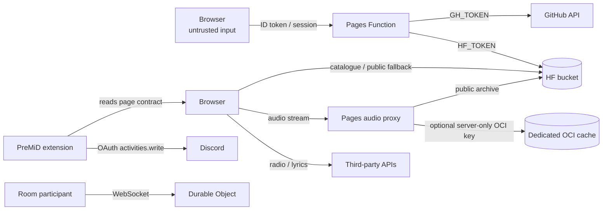

# Security

Aura Music is a single-owner personal app, but it still crosses several trust
boundaries: public CDNs, a public bucket, a browser extension, OAuth identity
tokens, a GitHub token, a Hugging Face token, and a public real-time room server.
This document maps what is trusted, what is not, and the known weaknesses.

## Trust boundaries

| Asset | Where it lives | Protection |
| --- | --- | --- |
| Google ID token / session | `localStorage` (`auraSession_v2`) | Client-side; XSS or device access exposes it |
| Device-local password hash | `localStorage` (`auraLocalAccounts_v1`) | PBKDF2-SHA256, 150k, per-account salt |
| Admin session | `localStorage` (same session key) | HMAC `v1` token signed with `GH_TOKEN`, 7 days |
| `GH_TOKEN` | Pages env | Server-side only; never sent to the client |
| `HF_TOKEN` / `HF_BUCKET_ID` | Pages env + GitHub secrets | Server-side/workflow write access; the bucket id itself is public configuration |
| `OCI_ACCESS_KEY` / `OCI_SECRET_KEY` | Pages env only | Optional dedicated hot-cache credentials; never shipped to the browser or defaulted from source |
| `AUDIO_ADMIN_TOKEN` | Pages env only | Bearer authorization for non-cacheable audio-cache aggregate diagnostics |
| `YOUTUBE_COOKIES` | GitHub Actions secret | Editable via admin API (sealed to GitHub’s public key) |
| Room admin key | URL/localStorage | 128-bit random; possession is authority |
| Uploaded audio/covers | HF bucket | Public read; writes require HF token |

## Authentication

### Google

- Browser verifies the ID token signature against Google’s JWKS, plus
  `exp`/`iat`, issuer, audience and `email_verified`.
- `/api/admin` repeats every check server-side before any GitHub/HF call. A
  browser-side check alone would be meaningless for authorization.
- The site accepts any Google account; only `ADMIN_EMAILS` (client hint) and
  `ALLOWED_EMAILS` (server truth) can use admin endpoints.

### Local fallback

- Email + password accounts exist only in this browser profile.
- PBKDF2-SHA256, 150,000 iterations, 16-byte random salt per account.
- Registration refuses an existing email; login compares the derived hash.
- This is a convenience fallback, not a replacement for Google verification.

### Admin password

- `ADMIN_PASSWORD` is optional. When set, `/api/admin` accepts
  `{action:'login', email, password}` for allow-listed emails.
- The password endpoint does **not** implement its own rate limiter. A strong
  unique password and an explicitly configured Cloudflare WAF/rate-limit rule
  are required for an exposed fallback login. This is **not** a password-hashing
  design for multi-user use; do not reuse a valuable password.
- Successful logins issue HMAC tokens keyed on `GH_TOKEN`; rotating `GH_TOKEN`
  invalidates all password sessions.

### Sessions

- Google ID tokens last ~1 h; the site exchanges them for a 7-day signed session
  via `/api/admin` (admins only).
- `getSession()` removes expired sessions on read.
- Session tokens are bearer credentials in `localStorage`. Any XSS on the origin
  can read them; there is no HttpOnly cookie because the site is static.

## XSS and HTML injection

The app builds HTML strings. The rules that keep that safe:

- All dynamic text/attributes pass through `escapeHtml()` (`core/dom.ts`).
  This applies to track titles/artists (bucket filenames and YouTube metadata),
  local file names, upload rows, toasts, state cards and presence data.
- Song-row menu ids are carried in `data-song-menu` and handled by a delegated
  listener instead of being interpolated into inline JavaScript. (Inline
  handlers with string ids previously produced syntax errors and could be used
  to inject code.)
- User-supplied URLs are restricted to `http(s)` for added tracks; `javascript:`
  URLs are rejected.
- Room chat is rendered with `textContent`, not `innerHTML`; chat length is
  capped at 500 characters.
- Playlist snapshot artwork is restricted to supported `http(s)`/relative URLs
  and raster base64 data images; imported SVG/script schemes are not accepted.
  The application's own vinyl SVG fallback is a trusted constant, not user
  markup. Audio import stores device files with filename metadata, without a
  tag-reading/CDN metadata service.

Known limits:

- There is **no Content-Security-Policy**. The app relies on inline event
  handlers (`onclick="…"`), inline scripts (theme bootstrap/loader) and external
  CDNs, so a strict CSP would require removing those patterns or adopting
  hashes/nonces for every page. A CSP is the highest-value hardening item.
- Google Identity Services and the YouTube IFrame API are loaded on demand from
  external providers without SRI. A compromised active script provider could
  execute on the origin. Fonts and Font Awesome SVG-mask icons are pinned and
  self-hosted; their licenses are retained under `docs/licenses/`.
- `window.state`, `window.playSong` and friends are intentionally exposed for
  inline handlers; any script running on the origin can call them. That is
  already game over after XSS.

## Secrets

| Secret | Exposure | Notes |
| --- | --- | --- |
| `GH_TOKEN` | Pages server | Needed for GitHub dispatches, secrets writes and repo staging. Use a fine-grained token limited to this repo: Actions (write), Contents (write), Secrets (write), Metadata (read). |
| `HF_TOKEN` | Pages + Actions | Bucket write. Never put it in `src/`. |
| `HF_BUCKET_ID` | Pages + Actions | Not secret per se, but keep consistent. |
| `ADMIN_PASSWORD` | Pages | Long random value; rotating it does not invalidate existing HMAC tokens (they are keyed on `GH_TOKEN`). |
| `YOUTUBE_COOKIES` | GitHub secret | Sensitive: it can access the YouTube account. Only the upload workflow consumes it. |
| `OCI_ACCESS_KEY` / `OCI_SECRET_KEY` | Pages server only | Restrict to the dedicated hot-cache bucket; require all configuration, with no source defaults. |
| `AUDIO_ADMIN_TOKEN` | Pages server only | Use a random bearer token for diagnostics; never a client variable or URL parameter. |
| Google client ID | Public | Not a secret; the audience is enforced server-side. |

Do not log secrets. The admin API never returns secret values — only names from
`status`.

## Audio cache security

The audio router is public read-only streaming for an already-public archive;
OCI acceleration is optional, not authentication for listening.

- The five OCI variables are environment-only and validated together. Missing,
  partial, blank, or malformed values cause **zero OCI calls or writes**, while
  public HF streaming remains available.
- Historical source contained an OCI customer-secret-key pair. The current
  source removes those defaults, but **the owner must revoke/rotate the exposed
  key in OCI**, update Production and Preview Pages env, and review IAM/storage
  activity. Neither editing files nor a later redeploy revokes that key. No
  remote key rotation or Git-history rewrite is performed by this remediation.
- `?action=status` only accepts `Authorization: Bearer <AUDIO_ADMIN_TOKEN>`;
  unauthorized callers always get a generic 404. Correctly authorized callers
  receive aggregate object/byte counts, not an inventory of track keys. Every
  diagnostic response varies on Authorization and is non-cacheable.
- Upstream exceptions, signed URLs, credential headers, storage keys and raw
  provider error bodies are never returned or logged by the audio cache path.
- Object keys are RFC 3986 encoded per segment; punctuation and Unicode cannot
  become a query, fragment, or request for a different object. Dot segments,
  malformed route escapes, controls, backslashes, protocol URLs, unsupported
  extensions, and invalid/multiple byte ranges are rejected before fetch.
- GET/HEAD and one valid byte range preserve upstream content-range/length;
  404 and 416 remain meaningful without reflecting raw provider bodies. The
  response forces the validated audio MIME type with `nosniff`, never a provider's
  `text/html`/SVG label as executable same-origin content. Compressed upstream
  length/encoding is not copied onto a decompressed response.
- Hot-cache uploads require `waitUntil`, read at most 25 MiB, reject declared
  length mismatches/partial content, and skip writes on failed capacity checks.
  Expensive eviction/writes are serialized within an isolate; listings paginate
  with signed markers and never evict non-audio objects.
- The 30-audio-object target is **best effort across isolates**. It is not a
  globally atomic quota or true LRU; eviction is oldest-object-first. Use a
  dedicated least-privilege bucket, storage-budget alerts, and infrastructure
  enforcement when a hard global limit is required.

The deterministic [audio security tests](../tests/unit/audio-security.spec.ts)
use fake credentials and replace every fetch; do not validate this implementation
by probing a live owner's cache or entering a real token into test scripts.

## Room security

- **No account is required.** A room link grants listening access; the admin
  key grants control. Treat the admin URL as a password.
- Room ids are 6 characters from a 31-character alphabet (~887 million
  combinations) and are enumerable in principle; they are not authentication.
- Admin keys are 16 random bytes (32 hex chars). Possession of the key is checked
  before participant role, so an admin who reconnects keeps control.
- The Worker allows `Access-Control-Allow-Origin: *` and WebSocket upgrades from
  any origin. This is intentional for a shareable room link; it also means any
  website can attempt to join a room if it knows the code. There is no CSRF
  concern for WebSocket JSON messages, but do not put secrets in room chat.
- Chat is rate-limited (5 messages / 5 s / participant) and capped in history.
- `buffering` is advisory only; it never pauses the room.
- The Durable Object has no persistent user accounts and deletes storage after
  the grace period.

## Data & privacy

- No first-party analytics, telemetry or Sentry integration is present in the
  app source.
- The browser calls Hugging Face for the library, radio-browser for stations,
  and Google for sign-in. Those providers see the user’s IP and relevant
  request. Font/icon providers receive no runtime page-load requests because
  those UI assets are self-hosted.
- Likes, recent plays, playlists, settings, and room names stay in the browser.
  There is no server-side user database or per-account playlist ACL. Signing out
  is not a wipe of all local collections; anyone with access to that browser
  profile or an origin script can read its local data.
- Playlist export intentionally transfers track references, order and metadata.
  Strict imported JSON validation rejects unsupported, oversized and duplicate
  payloads before mutation. Corrupt stored data freezes writes with recovery.
  Web Locks or short IndexedDB transaction locks coordinate cross-tab changes;
  no unsafe no-lock write is attempted. The file does not transfer audio blobs,
  storage credentials or a privacy permission; unavailable tracks remain
  recoverable entries. Local Restore retains identity. Cross-tab updates are not
  cloud synchronization.
- Version-1 snapshot links additionally allowlist only title/description,
  ordered track labels/keys and omission counts. Local audio, account details
  and media/artwork URLs are excluded. Anyone with the link can read it;
  fragments are not sent to the server and privacy labels do not enforce ACLs.
  Preview remains read-only; saving requires an explicit action. Legacy
  migration requires a saved verbatim backup before the primary store changes.
- Telepathy is quarantined under `experiments/telepathy/`, not imported into the
  app and not deployed as Pages Functions. Its tests force in-memory SQLite,
  fixture metadata/lyrics, and blocked external HTTP/sockets. The research API
  lacks a production auth/consent contract and must not be exposed publicly.
- The admin API sees Google ID tokens for verification but does not store them.
- PreMiD is a separate extension with its own privacy policy; it receives only
  the presence fields documented in [presence.md](presence.md).

## Operational hardening checklist

- [ ] Use a long random `ADMIN_PASSWORD` (or leave it unset and use Google only).
- [ ] Use a fine-grained `GH_TOKEN` limited to this repo/actions/secrets.
- [ ] Rotate `HF_TOKEN`, `GH_TOKEN`, `ADMIN_PASSWORD` and `YOUTUBE_COOKIES` after
      any suspected exposure.
- [ ] Revoke/rotate the historically embedded OCI customer key, update Production
      and Preview env, and review bucket/IAM activity. Source removal is not
      remote revocation.
- [ ] Use a dedicated least-privilege OCI cache bucket, quotas/alerts, and a
      separate random `AUDIO_ADMIN_TOKEN` if diagnostics are enabled.
- [ ] Run the mocked audio security suite before shipping; never store real
      credentials in fixtures, command history, `VITE_*`, or tracked `.dev.vars`.
- [ ] Keep the admin allow-list in sync in both `src/core/config.ts` and
      `functions/api/admin.ts`.
- [ ] Add a CSP once inline handlers are removed; retain self-hosted fonts/icons
      and consider SRI for suitable pinned external assets.
- [ ] Add rate limiting to `/api/admin` (Cloudflare WAF/rate-limit rule) because
      the Function itself has none.
- [ ] Keep the HF bucket write token server-side; the read side is public by
      design in this deployment.
- [ ] Review the custom sealed-box implementation in
      [`lib/sealedBox.ts`](../lib/sealedBox.ts) before changing crypto primitives;
      it exists because the Workers runtime forbids libsodium’s WASM.
- [ ] If the app becomes multi-user, replace the admin allow-list and shared
      password model with per-user auth and a real database.

## Reporting

This is a personal project without a formal security program. If you find an
issue in a deployment you own, rotate the relevant tokens first, then patch the
code and redeploy. For the PreMiD activity, report to the PreMiD project
separately — it is a third-party extension.
