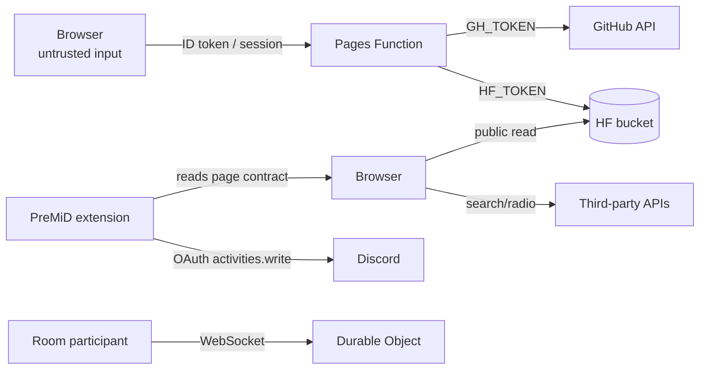

# Security

Aura Music is a single-owner personal app, but it still crosses several trust
boundaries: public CDNs, a public bucket, a browser extension, OAuth identity
tokens, a GitHub token, a Hugging Face token, and a public real-time room server.
This document maps what is trusted, what is not, and the known weaknesses.

## Trust boundaries

| Asset | Where it lives | Protection |
| --- | --- | --- |
| Google ID token / session | `localStorage` (`auraSession_v2`) | Client-side; XSS or device access exposes it |
| Device-local password hash | `localStorage` (`auraLocalAccounts_v1`) | PBKDF2-SHA256, 150k, per-account salt |
| Admin session | `localStorage` (same session key) | HMAC `v1` token signed with `GH_TOKEN`, 7 days |
| `GH_TOKEN` | Pages env | Server-side only; never sent to the client |
| `HF_TOKEN` / `HF_BUCKET_ID` | Pages env + GitHub secrets | Server-side/workflow only |
| `YOUTUBE_COOKIES` | GitHub Actions secret | Editable via admin API (sealed to GitHub’s public key) |
| Room admin key | URL/localStorage | 128-bit random; possession is authority |
| Uploaded audio/covers | HF bucket | Public read; writes require HF token |

## Authentication

### Google

- Browser verifies the ID token signature against Google’s JWKS, plus
  `exp`/`iat`, issuer, audience and `email_verified`.
- `/api/admin` repeats every check server-side before any GitHub/HF call. A
  browser-side check alone would be meaningless for authorization.
- The site accepts any Google account; only `ADMIN_EMAILS` (client hint) and
  `ALLOWED_EMAILS` (server truth) can use admin endpoints.

### Local fallback

- Email + password accounts exist only in this browser profile.
- PBKDF2-SHA256, 150,000 iterations, 16-byte random salt per account.
- Registration refuses an existing email; login compares the derived hash.
- This is a convenience fallback, not a replacement for Google verification.

### Admin password

- `ADMIN_PASSWORD` is optional. When set, `/api/admin` accepts
  `{action:'login', email, password}` for allow-listed emails.
- Both supplied and stored passwords are hashed with plain SHA-256 and compared.
  This is acceptable only because it is a single-owner panel with a strong
  password and a rate-limited attack surface (the Pages deployment), but it is
  **not** a password-hashing design for multi-user use. Do not reuse a valuable
  password.
- Successful logins issue HMAC tokens keyed on `GH_TOKEN`; rotating `GH_TOKEN`
  invalidates all password sessions.

### Sessions

- Google ID tokens last ~1 h; the site exchanges them for a 7-day signed session
  via `/api/admin` (admins only).
- `getSession()` removes expired sessions on read.
- Session tokens are bearer credentials in `localStorage`. Any XSS on the origin
  can read them; there is no HttpOnly cookie because the site is static.

## XSS and HTML injection

The app builds HTML strings. The rules that keep that safe:

- All dynamic text/attributes pass through `escapeHtml()` (`core/dom.ts`).
  This applies to track titles/artists (bucket filenames and YouTube metadata),
  local file names, upload rows, toasts, state cards and presence data.
- Song-row menu ids are carried in `data-song-menu` and handled by a delegated
  listener instead of being interpolated into inline JavaScript. (Inline
  handlers with string ids previously produced syntax errors and could be used
  to inject code.)
- User-supplied URLs are restricted to `http(s)` for added tracks; `javascript:`
  URLs are rejected.
- Room chat is rendered with `textContent`, not `innerHTML`; chat length is
  capped at 500 characters.
- Covers/audio are remote `http(s)` URLs; `data:` images are allowed only from
  local ID3 tags (not remote input).

Known limits:

- There is **no Content-Security-Policy**. The app relies on inline event
  handlers (`onclick="…"`), inline scripts (theme bootstrap/loader) and external
  CDNs, so a strict CSP would require removing those patterns or adopting
  hashes/nonces for every page. A CSP is the highest-value hardening item.
- External scripts (Font Awesome CSS, jsmediatags, Google Fonts, YouTube IFrame
  API) are loaded from CDNs without SRI. A CDN compromise could execute script
  on the origin. Pinning versions and adding SRI/native hosting would help.
- `window.state`, `window.playSong` and friends are intentionally exposed for
  inline handlers; any script running on the origin can call them. That is
  already game over after XSS.

## Secrets

| Secret | Exposure | Notes |
| --- | --- | --- |
| `GH_TOKEN` | Pages server | Needed for GitHub dispatches, secrets writes and repo staging. Use a fine-grained token limited to this repo: Actions (write), Contents (write), Secrets (write), Metadata (read). |
| `HF_TOKEN` | Pages + Actions | Bucket write. Never put it in `src/`. |
| `HF_BUCKET_ID` | Pages + Actions | Not secret per se, but keep consistent. |
| `ADMIN_PASSWORD` | Pages | Long random value; rotating it does not invalidate existing HMAC tokens (they are keyed on `GH_TOKEN`). |
| `YOUTUBE_COOKIES` | GitHub secret | Sensitive: it can access the YouTube account. Only the upload workflow consumes it. |
| Google client ID | Public | Not a secret; the audience is enforced server-side. |

Do not log secrets. The admin API never returns secret values — only names from
`status`.

## Room security

- **No account is required.** A room link grants listening access; the admin
  key grants control. Treat the admin URL as a password.
- Room ids are 6 characters from a 31-character alphabet (~887 million
  combinations) and are enumerable in principle; they are not authentication.
- Admin keys are 16 random bytes (32 hex chars). Possession of the key is checked
  before participant role, so an admin who reconnects keeps control.
- The Worker allows `Access-Control-Allow-Origin: *` and WebSocket upgrades from
  any origin. This is intentional for a shareable room link; it also means any
  website can attempt to join a room if it knows the code. There is no CSRF
  concern for WebSocket JSON messages, but do not put secrets in room chat.
- Chat is rate-limited (5 messages / 5 s / participant) and capped in history.
- `buffering` is advisory only; it never pauses the room.
- The Durable Object has no persistent user accounts and deletes storage after
  the grace period.

## Data & privacy

- No first-party analytics, telemetry or Sentry integration is present in the
  app source.
- The browser calls third-party APIs directly (HF, iTunes, Deezer, Audius,
  Jamendo, Archive.org, Openverse, ccMixter, YouTube, radio-browser). Those
  providers see the user’s IP and query; Google Fonts/Font Awesome/jsmediatags
  CDNs see page loads.
- Local library metadata, likes, recent plays, local audio and room names stay in
  the browser. There is no server-side user database.
- The admin API sees Google ID tokens for verification but does not store them.
- PreMiD is a separate extension with its own privacy policy; it receives only
  the presence fields documented in [presence.md](presence.md).

## Operational hardening checklist

- [ ] Use a long random `ADMIN_PASSWORD` (or leave it unset and use Google only).
- [ ] Use a fine-grained `GH_TOKEN` limited to this repo/actions/secrets.
- [ ] Rotate `HF_TOKEN`, `GH_TOKEN`, `ADMIN_PASSWORD` and `YOUTUBE_COOKIES` after
      any suspected exposure.
- [ ] Keep the admin allow-list in sync in both `src/core/config.ts` and
      `functions/api/admin.ts`.
- [ ] Add a CSP once inline handlers are removed; consider self-hosting Font
      Awesome/jsmediatags and adding SRI in the meantime.
- [ ] Add rate limiting to `/api/admin` (Cloudflare WAF/rate-limit rule) because
      the Function itself has none.
- [ ] Keep the HF bucket write token server-side; the read side is public by
      design in this deployment.
- [ ] Review the custom sealed-box implementation in
      [`lib/sealedBox.ts`](../lib/sealedBox.ts) before changing crypto primitives;
      it exists because the Workers runtime forbids libsodium’s WASM.
- [ ] If the app becomes multi-user, replace the admin allow-list and shared
      password model with per-user auth and a real database.

## Reporting

This is a personal project without a formal security program. If you find an
issue in a deployment you own, rotate the relevant tokens first, then patch the
code and redeploy. For the PreMiD activity, report to the PreMiD project
separately — it is a third-party extension.
